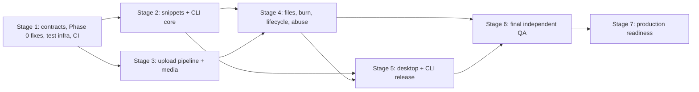

# Phase 1 implementation plan: micro-sharing

| | |
|---|---|
| Product | Zaagl (`zaa.gl`), TechTroll |
| Scope | PRD Phase 1: E1.1 snippets and CLI, E1.2 image and media drop, E1.3 ephemeral file transfer, E1.4 desktop tray app |
| Status | **PLANNING, awaiting approval.** No Phase 1 application code exists. |
| Baseline | Zaagl-Backend `1effe01` (branch `feat/phase0-click-events-utm`), Zaagl-Frontend `2c70b59` (`main`) |
| Plan owner | Lead architect (main Claude Code session) |
| Written | 2026-11-09, from six parallel planning agents (see AGENT_TASKS.md) |

## 1. Overview

Phase 1 turns Zaagl from a link shortener into a place to share code, images, recordings and files. The PRD's central promise is that **these assets plug into the same link engine, security gates and analytics built in Phase 0**. The plan keeps that promise:
- every share is a normal `zaa.gl` link;
- the link engine (leased-range codes, link states, gates, analytics, takedown) is extended, never redesigned;
- untrusted content never runs in a Zaagl origin that holds credentials.

The work is 195 tasks in 7 stages. Stage 1 builds contracts, prerequisites and test infrastructure. Each later stage ends at a QA gate that an independent QA agent must pass with evidence.

## 2. Requirements traceability (PRD Phase 1 → tasks)

| PRD requirement | Backend | Frontend | Desktop / CLI | DevOps | QA |
|---|---|---|---|---|---|
| E1.1 Paste code or text → `zaa.gl` link | BE-006, BE-007, BE-008 | FE-008, FE-009, FE-010 | DSK-010, CLI-008 | — | QA-018, QA-019 |
| E1.1 Syntax highlighting, 100+ languages, line numbers | BE-008 (language stored) | FE-007, FE-010 | — | — | QA-018 |
| E1.1 Markdown rendering | BE-009 | FE-011 | — | — | QA-017, QA-018 |
| E1.1 Side-by-side diff | BE-009 | FE-019 | — | — | QA-018 |
| E1.1 Copy Raw button | BE-008 (raw route) | FE-010 | — | OPS-010 | QA-016 |
| E1.1 CLI shares terminal output | BE-010, BE-024 | — | CLI-001…CLI-010 | OPS-025 | QA-020, QA-038 |
| E1.2 Drag-and-drop images, GIF, SVG, recordings | BE-011, BE-012, BE-015, BE-016 | FE-013, FE-014 | DSK-012 | OPS-008 | QA-021, QA-022, QA-023 |
| E1.2 100% original resolution and colour | BE-015 (originals untouched) | FE-015 | — | — | QA-024 |
| E1.2 Dark, light and checkerboard canvas; zoom loupe | — | FE-015 | — | — | QA-024 |
| E1.3 Documents, ZIP, PDF up to 5 GB on Pro | BE-003, BE-011, BE-012, BE-014, BE-017 | FE-013, FE-017, FE-018 | CLI-009, DSK-011 | OPS-009, OPS-010, OPS-012 | QA-025, QA-032, QA-034 |
| E1.3 Download page | BE-017 | FE-017 | — | OPS-010 | QA-027, QA-029 |
| E1.3 Burn After Downloading | BE-018 | FE-017 | — | — | QA-030, QA-047 |
| E1.3 Delete after X days | BE-019, BE-020 | FE-017 | — | OPS-012 | QA-031 |
| E1.4 Tray / menu bar app (Mac, Windows) | — | (shared UI, PD-21) | DSK-001…DSK-006, DSK-015, DSK-016 | OPS-023 | QA-036, QA-037 |
| E1.4 Ctrl/Cmd+Shift+Z shares the clipboard | BE-024 | — | DSK-007, DSK-008, DSK-009…DSK-012 | — | QA-037 |
| E1.4 Link on the clipboard with a chime | — | — | DSK-013 | — | QA-037 |
| PRD risk: code signing | — | — | DSK-017, CLI-012 | OPS-024, OPS-025 | QA-036 |
| PRD risk: storage cost bloat | BE-003, BE-019, BE-021 | FE-014 (quota bar) | — | OPS-002, OPS-012 | QA-032 |
| PRD risk: abuse and domain reputation | BE-022 | FE-026 | — | OPS-001 (separate domain) | QA-042 |
| Phase 1 exit gate: 30% install desktop/CLI | BE-024 (any account can sign in, PD-07) | — | DSK-019, CLI-013 | OPS-026 | — |
| Phase 1 exit gate: 3% free-to-Pro | BE-003 (Pro tier, PD-04) | — | — | — | — |

The business exit gates (30% installs, 3+ shares per user per day, 3% conversion) need real usage. Code alone cannot meet them; the plan only removes the technical blockers.

## 3. Existing architecture and reusable Phase 0 components

Details and file references are in ARCHITECTURE.md §1. In short:

| Reused as-is | Must be extended (additive) | Missing or unverified |
|---|---|---|
| Code issuing (leases + Feistel), namespace and alias rules, link state function, atomic click limit, idempotency keys, cache + NOTIFY invalidation, analytics pipeline, abuse reports, takedown core, JWT auth, host routing | Link model is URL-only (`target_kind` + `resource_id` needed); AccessGate must become a contract with grants and link keys; Billing assumes "paid = Starter" (no Pro); analytics has no event kind; safety re-check, purge and export assume a URL | API-key scopes never enforced; forwarded headers trusted from anyone; redirect route has no rate limit and accepts 3-character paths; `IFileStorage` has no implementation; Worker and Wolverine unused; tokens in `localStorage`; tests share one database; no CI; no Nginx or production compose |

## 4. Proposed Phase 1 architecture (summary)

Full detail: ARCHITECTURE.md, API_CONTRACTS.md, DATABASE_AND_STORAGE.md.

- **One namespace.** A share is a Link with `target_kind` and `resource_id`. `zaa.gl/<code>` runs the existing gates, then answers 302 to the viewer on `app.zaa.gl/{p,i,f}/<code>` (PD-02).
- **New modules:** Resources (envelope, ownership, lifecycle, quota, burn, grants), Snippets (text and versions), Files (uploads, objects, scanning, delivery), Media (metadata and derived previews). They talk to Links, Access, Billing and Analytics only through Contracts.
- **Bytes** are served only from a separate registrable domain (`dl.<ucd>`, DNS-only, Nginx X-Accel-Redirect) through 120-second signed tickets, as attachments or under a sandbox CSP (PD-03).
- **Uploads:** tus, resumable, to `storage/temp`, then type detection, SHA-256, ClamAV (fail-closed), then a move to `storage/objects`. Originals are never modified (PD-12 decides the upload host).
- **Private content** carries a 128-bit key in the URL fragment (PD-01).
- **Jobs:** PostgreSQL task tables claimed with `SKIP LOCKED`, run by `Zaagl.Worker` (PD-25).
- **CLI and desktop** sign in with the OAuth device flow, available to every account (PD-07).

## 5. Workstreams and dependencies

Twelve shared contracts (C1–C12, ARCHITECTURE.md §5) must be agreed in Stage 1 before parallel implementation starts. Each has one owner. Stages 2 and 3 can run in parallel once Stage 1 passes its gate.

## 6. Stages, milestones and gates

| Stage | Goal | Lead | Parallel agents | Tasks | Gate (evidence required: SECURITY_AND_QA.md §4) |
|---|---|---|---|---|---|
| 1 | Contracts and ADRs, Phase 0 security fixes, plan and limits model, test isolation, CI, BFF session | Architect | Backend, Frontend, DevOps, QA | 52 | Architecture approved; contracts compile; CI green on both repos; QA-001..011 PASS; Phase 0 defects F-02/F-03/F-04 fixed |
| 2 | Snippets end to end, Markdown, diff, CLI core (login, paste, link) | Backend + Frontend | CLI, QA | 31 | Snippet sharing verified end to end; XSS corpus 0 executions; CLI paste works on 3 OSes |
| 3 | Upload pipeline (tus, detection, scan, promote), media viewer | Backend + Frontend | DevOps, QA | 29 | Original-quality sharing verified (SHA-256 round trip); SVG and bomb suites PASS; infected file never servable |
| 4 | File download page, burn, expiry, quotas, abuse for content, analytics kinds | Backend + Frontend | DevOps, QA | 25 | Burn race suite exactly-once in every run; expiry and orphan checker consistent; takedown within bound |
| 5 | Desktop tray app, CLI uploads, signing, distribution | Desktop/CLI | Backend, DevOps, QA | 34 | Desktop and CLI workflows verified on Windows and macOS; signed builds |
| 6 | Final independent QA, pen-test, traceability, mutation testing | QA | all engineers fix | 7 | No open S1/S2 defects; all Phase 0 regressions PASS |
| 7 | Production compose, Nginx, backups and restore drill, monitoring, staging, load tests | DevOps + Architect | QA | 17 | Restore drill passed; load test within targets; or remaining blockers explicitly documented |

Stage task counts include the three tasks added during consolidation (BE-030, BE-031, FE-029, all Stage 1).

## 7. Task format and Definition of Done

Each task has a stable ID, title, owning agent, priority, dependencies and the document holding its detail (index in §11). The detail documents carry the description, files, API and database impact, acceptance criteria and tests written by the owning agent.

**Full task cards** (implementation steps, deliverables, exact test names) are written by the owner at the **start of each stage**, for that stage's tasks only, and reviewed by the architect before work begins. Writing all 195 now would describe code against contracts that Stage 1 has not fixed yet.

**Definition of Done (every task):**
1. Implemented against the approved contracts. No module reads another module's non-Contracts code.
2. Integrated: frontend and backend changes land together, and the OpenAPI document is updated.
3. Acceptance criteria pass, shown by automated tests that run in CI (or recorded BLOCKED with the reason).
4. Security requirements of SECURITY_AND_QA.md §3 that touch the task pass.
5. Phase 0 regression suite passes.
6. Documentation and STATUS.md are updated, with the commit hash.
7. QA has recorded evidence (PASS/FAIL/BLOCKED/NOT_TESTED) independently of the developer.
8. The lead architect accepts it.

## 8. QA gates and the final independent QA

- QA defines coverage during planning (done: SECURITY_AND_QA.md).
- At every stage gate QA verifies the stage independently, with evidence, using the entry and exit criteria in SECURITY_AND_QA.md §4.
- Defects follow SECURITY_AND_QA.md §5: the owning engineer fixes, QA retests. Any open S1 or S2 defect blocks the gate.
- Stage 6 is a separate system-wide pass over all Phase 1 features plus Phase 0 regressions, then a pen-test (QA-045).
- A result that cannot be produced (for example, container tests without Docker) is recorded as BLOCKED or NOT_TESTED, never as passing.

## 9. Risks

| Risk | Effect | Mitigation |
|---|---|---|
| No Docker on the development machine (firmware virtualisation off) | ClamAV, Nginx, Testcontainers and chaos tests cannot run locally | CI with containers is a Stage 1 exit item (QA-004, QA-005); a staging host by Stage 4 (PD-27) |
| Phase 0 defects under Phase 1 (scopes, spoofable IP, redirect limits, token storage) | Content would inherit them | Fixed in Stage 1 (PD-24, PD-23) |
| Spec v9.4 covers short links only | No oracle for content behaviour | The Stage 1 contract pack becomes the Phase 1 addendum (PD-34) |
| 5 GB uploads on a single VPS | Disk full can take PostgreSQL down | Separate data volume, admission control with 507, alerts (OPS-011, OPS-012) |
| Hosting user content in the EU | DSA and CSAM duties | Legal review before public launch (PD-11) |
| Code signing procurement takes weeks | Stage 5 cannot release | Start procurement in Stage 1 (PD-20) |
| Scope size (195 tasks, about 7 roles) | Long timeline | Stages 2 and 3 run in parallel; P2/P3 tasks can move to a Phase 1.1 |

## 10. Blockers

| Blocker | Blocks | Owner |
|---|---|---|
| 35 product decisions: 12 approved on 2026-11-09; the rest are needed by later stages | 14 tasks marked BLOCKED in STATUS.md (3 of them deferred test-isolation tasks) | Product owner / head of tech (DECISIONS.md) |
| User-content subdomain name and DNS (PD-03 approved: a `zaa.gl` subdomain, no purchase) | OPS-001, OPS-010, ARC-008 | DevOps + architect |
| Apple Developer ID and Windows signing not procured (PD-20) | DSK-017, CLI-012, OPS-024 | Product owner |
| Docker unavailable locally | Local container tests | Enable virtualisation in the BIOS and install Docker Desktop (admin), or rely on CI |
| Staging host not budgeted (PD-27) | Performance and recovery evidence | Product owner |

## 11. Task index

Columns: ID, title, owning agent, priority, dependencies as written in the draft (draft question ids map to PD-nn in DECISIONS.md), and the document that holds the detail. Live status is in STATUS.md.

### Stage 1: Architecture, contracts and foundation (52 tasks)

| ID | Title | Owner | Pri | Depends on | Detail in |
|---|---|---|---|---|---|
| ARC-001 | Phase 1 contract pack and ADR set | architect | P0 | none | ARCHITECTURE.md |
| ARC-002 | Link target model (content links) | architect | P0 | ARC-001 | ARCHITECTURE.md |
| ARC-004 | Access gate as a contract + grants + link key | architect | P0 | ARC-001 | ARCHITECTURE.md |
| ARC-005 | Plan model v2 (Pro + ContentLimits + capability flags) | architect | P0 | D-3, D-4 | ARCHITECTURE.md |
| ARC-006 | Resource lifecycle and quota state machine | architect | P0 | ARC-002, ARC-005 | ARCHITECTURE.md |
| ARC-008 | User-content domain and delivery path | architect | P0 | D-1, D-2 | ARCHITECTURE.md |
| ARC-014 | Client auth for CLI and desktop + scope enforcement | architect | P0 | D-3 | ARCHITECTURE.md |
| ARC-016 | Public content API (OpenAPI) review | architect | P0 | ARC-002, ARC-004, ARC-006 | ARCHITECTURE.md |
| BE-001 | Enforce API-key scopes; add content scopes | backend | P0 | — | DATABASE_AND_STORAGE.md / API_CONTRACTS.md |
| BE-002 | RFC 7807 type URIs and new error codes | backend | P0 | — | DATABASE_AND_STORAGE.md / API_CONTRACTS.md |
| BE-003 | Pro tier and content limits | backend | P0 | Q1, Q3 | DATABASE_AND_STORAGE.md / API_CONTRACTS.md |
| BE-004 | IFileStorage v2 + LocalFileStorage | backend | P0 | — | DATABASE_AND_STORAGE.md / API_CONTRACTS.md |
| BE-005 | Content/upload host, headers, Kestrel limits | backend | P0 | devops (Nginx/DNS) | DATABASE_AND_STORAGE.md / API_CONTRACTS.md |
| BE-006 | Resources module skeleton | backend | P0 | BE-004 | DATABASE_AND_STORAGE.md / API_CONTRACTS.md |
| BE-007 | Link-to-content binding (per architect LO-A/B/C) | backend | P0 | architect | DATABASE_AND_STORAGE.md / API_CONTRACTS.md |
| BE-013 | Worker host + task queue | backend | P0 | — | DATABASE_AND_STORAGE.md / API_CONTRACTS.md |
| BE-030 | Trust X-Forwarded-For only from exact known proxies (spec §7.13); fixes spoofable client IP | backend | P0 | none | DATABASE_AND_STORAGE.md / API_CONTRACTS.md |
| BE-031 | Redirect hardening: §7.3 redirect and tiered miss rate limits, 404 for 1-3 character and multi-segment paths before I/O | backend | P0 | BE-030, ARC-013 | DATABASE_AND_STORAGE.md / API_CONTRACTS.md |
| FE-001 | Phase 1 foundation and Next 16 verification | frontend | P0 | ARC-xxx(hosts) | FRONTEND_PLAN.md |
| FE-002 | Test tooling | frontend | P0 | — | FRONTEND_PLAN.md |
| FE-003 | Security headers and CSP | frontend | P0 | OPS-xxx(nginx), ARC-xxx(content domain) | FRONTEND_PLAN.md |
| FE-004 | Shared libs refactor | frontend | P0 | — | FRONTEND_PLAN.md |
| FE-005 | Extract LinkForm sections | frontend | P0 | — | FRONTEND_PLAN.md |
| FE-006 | Types and query hooks | frontend | P0 | BE-xxx(API-S*, U*, R*, V*, B1) | FRONTEND_PLAN.md |
| FE-029 | BFF session: tokens in a server-side HttpOnly __Host- cookie, CSRF double-submit, no tokens in localStorage (spec §7.13) | frontend | P0 | FE-027, BE-030 | FRONTEND_PLAN.md |
| OPS-001 | Buy and wire the user-content domain + DNS plan | devops | P0 | Q2 | DEVOPS_PLAN.md |
| OPS-002 | Storage policy & capacity sign-off | devops | P0 | Q1, Q3 | DEVOPS_PLAN.md |
| OPS-003 | Image hygiene | devops | P0 | – | DEVOPS_PLAN.md |
| OPS-004 | backend-ci workflow | devops | P0 | – | DEVOPS_PLAN.md |
| OPS-005 | Migrations check | devops | P0 | OPS-004 | DEVOPS_PLAN.md |
| OPS-006 | frontend-ci workflow | devops | P0 | – | DEVOPS_PLAN.md |
| OPS-014 | Secrets for Phase 1 | devops | P0 | – | DEVOPS_PLAN.md |
| QA-001 | Confirm and document the AdminApiTests flake | qa | P0 | PG up | SECURITY_AND_QA.md |
| QA-002 | Per-class test database harness | qa | P0 | QA-001 | SECURITY_AND_QA.md |
| QA-003 | Isolate global-sweep tests | qa | P0 | QA-002 | SECURITY_AND_QA.md |
| QA-004 | CI pipeline | qa | P0 | QA-002 | SECURITY_AND_QA.md |
| QA-006 | Zaagl.Api.Tests WAF harness | qa | P0 | QA-002 | SECURITY_AND_QA.md |
| QA-007 | Link creation safety net | qa | P0 | QA-006 | SECURITY_AND_QA.md |
| QA-008 | Redirect endpoint safety net | qa | P0 | QA-006 | SECURITY_AND_QA.md |
| QA-009 | AccessGate and unlock safety net | qa | P0 | QA-006 | SECURITY_AND_QA.md |
| QA-010 | Generated authorization matrix | qa | P0 | QA-006 | SECURITY_AND_QA.md |
| QA-011 | Rate-limit and client-IP tests | qa | P0 | QA-006 | SECURITY_AND_QA.md |
| QA-013 | Redirect latency baseline | qa | P0 | QA-004 | SECURITY_AND_QA.md |
| QA-015 | Phase 1 threat model review | qa | P0 | designs | SECURITY_AND_QA.md |
| QA-039 | Frontend test bootstrap | qa | P0 | QA-004 | SECURITY_AND_QA.md |
| QA-040 | Token storage risk (F-04) | qa | P0 | none | SECURITY_AND_QA.md |
| ARC-012 | Worker and job hosting decision (Wolverine) | architect | P1 | none | ARCHITECTURE.md |
| ARC-013 | Rate limiting v2 | architect | P1 | ARC-008 | ARCHITECTURE.md |
| BE-027 | Test harness for content | backend | P1 | BE-004 | DATABASE_AND_STORAGE.md / API_CONTRACTS.md |
| FE-027 | BFF readiness spike | frontend | P1 | ARC-xxx(BFF) | FRONTEND_PLAN.md |
| QA-014 | Architecture tests | qa | P1 | QA-004 | SECURITY_AND_QA.md |
| ARC-017 | Architecture tests | architect | P2 | ARC-001 | ARCHITECTURE.md |

### Stage 2: Code and text sharing (E1.1, CLI core) (31 tasks)

| ID | Title | Owner | Pri | Depends on | Detail in |
|---|---|---|---|---|---|
| ARC-003 | Resolution flow for content kinds | architect | P0 | ARC-002, ARC-004 | ARCHITECTURE.md |
| BE-008 | Snippets CRUD + versions + public read + raw | backend | P0 | BE-006, BE-007, BE-001 | DATABASE_AND_STORAGE.md / API_CONTRACTS.md |
| BE-010 | CLI text ingest | backend | P0 | BE-008 | DATABASE_AND_STORAGE.md / API_CONTRACTS.md |
| CLI-001 | Scaffold AOT CLI and CI matrix | desktop-cli | P0 | - | DESKTOP_CLI_PLAN.md |
| CLI-002 | Command framework, output modes, exit codes | desktop-cli | P0 | CLI-001 | DESKTOP_CLI_PLAN.md |
| CLI-003 | HTTP client and error mapping | desktop-cli | P0 | CLI-001, ARC-API-PREFIX | DESKTOP_CLI_PLAN.md |
| CLI-004 | Credential stores | desktop-cli | P0 | CLI-001 | DESKTOP_CLI_PLAN.md |
| CLI-005 | login/logout/whoami via device flow | desktop-cli | P0 | CLI-004, BE-AUTH-DEVICE, FE-ACTIVATE, BE-AUTH-NATIVE | DESKTOP_CLI_PLAN.md |
| CLI-006 | Token refresh with cross-process lock | desktop-cli | P0 | CLI-005 | DESKTOP_CLI_PLAN.md |
| CLI-007 | link <url> | desktop-cli | P0 | CLI-003, CLI-006, BE-LINKS-SHORTURL, BE-AUTH-SCOPES | DESKTOP_CLI_PLAN.md |
| CLI-008 | paste from stdin | desktop-cli | P0 | CLI-007, BE-SNIPPET-CREATE, BE-CAPS | DESKTOP_CLI_PLAN.md |
| FE-007 | Highlighting module | frontend | P0 | FE-001 | FRONTEND_PLAN.md |
| FE-008 | SnippetEditor + LanguagePicker + detection | frontend | P0 | FE-007 | FRONTEND_PLAN.md |
| FE-009 | /paste/new page | frontend | P0 | FE-005, FE-006, FE-008, BE-xxx(API-S1) | FRONTEND_PLAN.md |
| FE-010 | Snippet viewer /p/[slug] | frontend | P0 | FE-007, FE-012, BE-xxx(API-V1, V4) | FRONTEND_PLAN.md |
| FE-012 | Viewer gates and states | frontend | P0 | FE-001, FE-004, BE-xxx(API-V2, V3, V5) | FRONTEND_PLAN.md |
| QA-016 | Content-origin header contract suite | qa | P0 | QA-006, Q-01 | SECURITY_AND_QA.md |
| QA-017 | Markdown sanitizer corpus | qa | P0 | snippet design | SECURITY_AND_QA.md |
| QA-018 | Snippet E2E and XSS execution oracle | qa | P0 | QA-039, QA-017 | SECURITY_AND_QA.md |
| QA-038 | CLI token handling and AOT smoke | qa | P0 | CLI build | SECURITY_AND_QA.md |
| ARC-010 | Snippet model and rendering safety | architect | P1 | ARC-006, D-9 | ARCHITECTURE.md |
| BE-009 | Markdown + diff | backend | P1 | BE-008 | DATABASE_AND_STORAGE.md / API_CONTRACTS.md |
| BE-024 | CLI/desktop auth | backend | P1 | BE-001, Q5 | DATABASE_AND_STORAGE.md / API_CONTRACTS.md |
| BE-026 | Rate-limit policies + guest snippets (if approved) | backend | P1 | — | DATABASE_AND_STORAGE.md / API_CONTRACTS.md |
| CLI-010 | ls and config | desktop-cli | P1 | CLI-002, BE-CONTENT-LIST | DESKTOP_CLI_PLAN.md |
| FE-011 | Markdown rendering | frontend | P1 | FE-007, ARC-xxx(markdown) | FRONTEND_PLAN.md |
| FE-019 | Versions and diff | frontend | P1 | FE-010, BE-xxx(API-S3..S5, V4) | FRONTEND_PLAN.md |
| FE-021 | i18n/RTL completeness | frontend | P1 | all UI tasks | FRONTEND_PLAN.md |
| QA-019 | Snippet API contract | qa | P1 | QA-006 | SECURITY_AND_QA.md |
| QA-020 | CLI snippet and terminal piping | qa | P1 | zaagl streaming, encoding (UTF-8, UTF-16 from PowerShell), ANSI escape stripping or preserving per spec, exit codes. | SECURITY_AND_QA.md |
| BE-028 | Docs + OpenAPI | backend | P2 | — | DATABASE_AND_STORAGE.md / API_CONTRACTS.md |

### Stage 3: Image and media sharing (E1.2, upload pipeline) (29 tasks)

| ID | Title | Owner | Pri | Depends on | Detail in |
|---|---|---|---|---|---|
| ARC-009 | Upload pipeline (tus → temp → scan → promote) | architect | P0 | ARC-006, ARC-008, D-12 | ARCHITECTURE.md |
| BE-011 | tus upload sessions | backend | P0 | BE-004, BE-005, BE-006, BE-003 | DATABASE_AND_STORAGE.md / API_CONTRACTS.md |
| BE-012 | Finalize + identification | backend | P0 | BE-011 | DATABASE_AND_STORAGE.md / API_CONTRACTS.md |
| BE-014 | ClamAV scan + quarantine | backend | P0 | BE-012, BE-013 | DATABASE_AND_STORAGE.md / API_CONTRACTS.md |
| BE-017 | Download tickets + X-Accel delivery | backend | P0 | BE-005, BE-006, BE-004 | DATABASE_AND_STORAGE.md / API_CONTRACTS.md |
| FE-013 | Uploader (tus) | frontend | P0 | FE-005, FE-006, BE-xxx(API-U1..U4), OPS-xxx(files host CORS) | FRONTEND_PLAN.md |
| FE-014 | Files & media library /files | frontend | P0 | FE-013, BE-xxx(API-R1, R2, R4, B1) | FRONTEND_PLAN.md |
| FE-015 | Image viewer /i/[slug] (+ SVG, GIF) | frontend | P0 | FE-012, BE-xxx(API-V1), OPS-xxx(content domain) | FRONTEND_PLAN.md |
| OPS-007 | Production compose | devops | P0 | OPS-003, OPS-014 | DEVOPS_PLAN.md |
| OPS-008 | Worker image + service | devops | P0 | OPS-007, backend worker | DEVOPS_PLAN.md |
| OPS-009 | ClamAV service | devops | P0 | OPS-007 | DEVOPS_PLAN.md |
| OPS-010 | Nginx configuration | devops | P0 | OPS-001, OPS-007 | DEVOPS_PLAN.md |
| OPS-011 | Host provisioning | devops | P0 | OPS-002 | DEVOPS_PLAN.md |
| OPS-012 | Disk admission & thresholds contract | devops | P0 | OPS-002 | DEVOPS_PLAN.md |
| QA-021 | Content-type detection and polyglot corpus | qa | P0 | upload design | SECURITY_AND_QA.md |
| QA-022 | SVG security suite | qa | P0 | QA-016 | SECURITY_AND_QA.md |
| QA-023 | Image and video bomb suite | qa | P0 | media worker | SECURITY_AND_QA.md |
| QA-025 | Malware scanning fail-closed | qa | P0 | QA-005 | SECURITY_AND_QA.md |
| QA-026 | Filename, traversal and header injection | qa | P0 | upload design | SECURITY_AND_QA.md |
| QA-027 | IDOR suite for snippets, files and media | qa | P0 | QA-010 | SECURITY_AND_QA.md |
| QA-028 | Storage isolation | qa | P0 | QA-005 | SECURITY_AND_QA.md |
| QA-029 | Download token tests | qa | P0 | token design | SECURITY_AND_QA.md |
| ARC-011 | Media fidelity and processing | architect | P1 | ARC-009, D-13 | ARCHITECTURE.md |
| BE-015 | Media metadata + derivatives | backend | P1 | BE-014 | DATABASE_AND_STORAGE.md / API_CONTRACTS.md |
| BE-016 | SVG safe view | backend | P1 | BE-015 | DATABASE_AND_STORAGE.md / API_CONTRACTS.md |
| FE-016 | Video player for recordings | frontend | P1 | FE-015, BE-xxx(transcode variants) | FRONTEND_PLAN.md |
| QA-005 | Testcontainers in CI | qa | P1 | QA-004 | SECURITY_AND_QA.md |
| QA-024 | Media fidelity and viewer E2E | qa | P1 | QA-039 | SECURITY_AND_QA.md |
| FE-024 | Viewer metadata/OG | frontend | P2 | BE-xxx(API-V1) | FRONTEND_PLAN.md |

### Stage 4: Ephemeral file transfer (E1.3, lifecycle, abuse) (25 tasks)

| ID | Title | Owner | Pri | Depends on | Detail in |
|---|---|---|---|---|---|
| BE-018 | Burn After Downloading | backend | P0 | BE-017, Q11–Q16 | DATABASE_AND_STORAGE.md / API_CONTRACTS.md |
| BE-019 | Resource expiry/purge + link coupling | backend | P0 | BE-006, BE-007 | DATABASE_AND_STORAGE.md / API_CONTRACTS.md |
| FE-017 | Download page /f/[slug] + burn | frontend | P0 | FE-012, BE-xxx(API-V1, V5) | FRONTEND_PLAN.md |
| QA-030 | Burn-after-download race suite | qa | P0 | QA-006, Q-03 | SECURITY_AND_QA.md |
| QA-031 | Expiry, deletion and orphan reconciliation | qa | P0 | QA-002 | SECURITY_AND_QA.md |
| QA-032 | Quota bypass suite | qa | P0 | upload design | SECURITY_AND_QA.md |
| QA-033 | Upload abuse and limits | qa | P0 | QA-011 | SECURITY_AND_QA.md |
| QA-035 | Recovery suite | qa | P0 | §2.2 seams | SECURITY_AND_QA.md |
| QA-047 | Preview-bot behaviour on content links | qa | P0 | QA-030 | SECURITY_AND_QA.md |
| ARC-007 | Analytics event kinds | architect | P1 | ARC-001 | ARCHITECTURE.md |
| ARC-015 | Content abuse and takedown | architect | P1 | ARC-002, ARC-009 | ARCHITECTURE.md |
| BE-020 | Orphans + reconciliation | backend | P1 | BE-011, BE-013 | DATABASE_AND_STORAGE.md / API_CONTRACTS.md |
| BE-021 | Quotas endpoint + ledger recompute | backend | P1 | BE-011 | DATABASE_AND_STORAGE.md / API_CONTRACTS.md |
| BE-022 | Abuse for content | backend | P1 | BE-006, BE-012 | DATABASE_AND_STORAGE.md / API_CONTRACTS.md |
| BE-023 | Account deletion + export | backend | P1 | BE-006 | DATABASE_AND_STORAGE.md / API_CONTRACTS.md |
| FE-018 | PdfPreview | frontend | P1 | FE-017, ARC-xxx(pdf preview), OPS-xxx(content CORS/Range) | FRONTEND_PLAN.md |
| FE-020 | Owner detail pages /paste/[id], /files/[id] | frontend | P1 | FE-009, FE-014, BE-xxx(API-S2, R2) | FRONTEND_PLAN.md |
| FE-025 | Library integration in /links | frontend | P1 | BE-xxx(API-R3) | FRONTEND_PLAN.md |
| OPS-013 | TLS automation | devops | P1 | OPS-001, OPS-010 | DEVOPS_PLAN.md |
| QA-012 | Takedown and NOTIFY invalidation | qa | P1 | QA-006 | SECURITY_AND_QA.md |
| QA-041 | Account deletion and export with content | qa | P1 | QA-031 | SECURITY_AND_QA.md |
| QA-042 | Content takedown and abuse flows | qa | P1 | QA-012 | SECURITY_AND_QA.md |
| QA-048 | Metadata privacy decision test | qa | P1 | Q-06 | SECURITY_AND_QA.md |
| BE-025 | View/download analytics | backend | P2 | — | DATABASE_AND_STORAGE.md / API_CONTRACTS.md |
| OPS-030 | Bandwidth controls | devops | P2 | OPS-010 | DEVOPS_PLAN.md |

### Stage 5: Desktop app and CLI distribution (E1.4) (34 tasks)

| ID | Title | Owner | Pri | Depends on | Detail in |
|---|---|---|---|---|---|
| CLI-009 | share <path> with resumable upload | desktop-cli | P0 | CLI-003, BE-UPLOAD | DESKTOP_CLI_PLAN.md |
| CLI-012 | Signing, notarisation, release artefacts | desktop-cli | P0 | CLI-001, ARC-SIGNING | DESKTOP_CLI_PLAN.md |
| DSK-001 | Scaffold Tauri 2 app and CI | desktop-cli | P0 | - | DESKTOP_CLI_PLAN.md |
| DSK-003 | API client core | desktop-cli | P0 | ARC-API-PREFIX | DESKTOP_CLI_PLAN.md |
| DSK-004 | Device-flow sign-in and keyring storage | desktop-cli | P0 | BE-AUTH-DEVICE, FE-ACTIVATE, BE-AUTH-NATIVE | DESKTOP_CLI_PLAN.md |
| DSK-005 | Token manager: refresh, revoke, sign-out | desktop-cli | P0 | DSK-004, BE-AUTH-SESSIONS | DESKTOP_CLI_PLAN.md |
| DSK-006 | Tray / menu bar | desktop-cli | P0 | DSK-001 | DESKTOP_CLI_PLAN.md |
| DSK-007 | Global shortcut with conflict handling | desktop-cli | P0 | DSK-001, Q1 | DESKTOP_CLI_PLAN.md |
| DSK-008 | Clipboard snapshot and classifier | desktop-cli | P0 | DSK-001 | DESKTOP_CLI_PLAN.md |
| DSK-009 | Share URL | desktop-cli | P0 | DSK-003, DSK-005, DSK-008, BE-LINKS-SHORTURL, BE-AUTH-SCOPES | DESKTOP_CLI_PLAN.md |
| DSK-010 | Share text/code as snippet | desktop-cli | P0 | DSK-009, BE-SNIPPET-CREATE, BE-CAPS | DESKTOP_CLI_PLAN.md |
| DSK-011 | Resumable upload engine (tus) | desktop-cli | P0 | DSK-003, BE-UPLOAD | DESKTOP_CLI_PLAN.md |
| DSK-012 | Share file and screenshot | desktop-cli | P0 | DSK-008, DSK-011, BE-CAPS | DESKTOP_CLI_PLAN.md |
| DSK-017 | Signing and notarisation pipeline | desktop-cli | P0 | ARC-SIGNING | DESKTOP_CLI_PLAN.md |
| QA-036 | Desktop security review | qa | P0 | desktop build | SECURITY_AND_QA.md |
| CLI-011 | API-key mode for CI | desktop-cli | P1 | CLI-004, BE-AUTH-SCOPES, ARC-FREE-CLI | DESKTOP_CLI_PLAN.md |
| CLI-013 | Package managers | desktop-cli | P1 | CLI-012 | DESKTOP_CLI_PLAN.md |
| DSK-002 | Shared UI package adoption | desktop-cli | P1 | Frontend extraction (Q9) | DESKTOP_CLI_PLAN.md |
| DSK-013 | Chime and notifications | desktop-cli | P1 | DSK-009 | DESKTOP_CLI_PLAN.md |
| DSK-014 | Offline and error UX | desktop-cli | P1 | DSK-011, DSK-013 | DESKTOP_CLI_PLAN.md |
| DSK-015 | Settings window | desktop-cli | P1 | DSK-002, BE-CAPS | DESKTOP_CLI_PLAN.md |
| DSK-016 | Autostart | desktop-cli | P1 | DSK-015 | DESKTOP_CLI_PLAN.md |
| DSK-018 | Auto-update | desktop-cli | P1 | DSK-017, BE-CLIENTVER | DESKTOP_CLI_PLAN.md |
| DSK-019 | Distribution channels | desktop-cli | P1 | DSK-017 | DESKTOP_CLI_PLAN.md |
| DSK-020 | Desktop E2E and OS matrix | desktop-cli | P1 | DSK-009..012 | DESKTOP_CLI_PLAN.md |
| OPS-023 | Desktop CI (unsigned) | devops | P1 | Q7 | DEVOPS_PLAN.md |
| OPS-024 | Desktop signing/notarisation/updater | devops | P1 | OPS-023 | DEVOPS_PLAN.md |
| OPS-025 | CLI CI + signing | devops | P1 | Q7 | DEVOPS_PLAN.md |
| QA-037 | Desktop functional matrix | qa | P1 | desktop build | SECURITY_AND_QA.md |
| CLI-014 | Completions, update check, docs | desktop-cli | P2 | CLI-002, BE-CLIENTVER | DESKTOP_CLI_PLAN.md |
| CLI-015 | rm, open, --copy | desktop-cli | P2 | CLI-010, BE-CONTENT-DELETE | DESKTOP_CLI_PLAN.md |
| DSK-021 | Loopback PKCE sign-in | desktop-cli | P2 | BE-AUTH-LOOPBACK | DESKTOP_CLI_PLAN.md |
| DSK-022 | Recent shares and quick actions | desktop-cli | P2 | BE-CONTENT-LIST, BE-CONTENT-DELETE | DESKTOP_CLI_PLAN.md |
| OPS-026 | Release distribution | devops | P2 | OPS-024, OPS-025 | DEVOPS_PLAN.md |

### Stage 6: Final independent QA (7 tasks)

| ID | Title | Owner | Pri | Depends on | Detail in |
|---|---|---|---|---|---|
| QA-045 | Stage 6 exploratory pen-test | qa | P0 | Stages 2-5 | SECURITY_AND_QA.md |
| FE-022 | Accessibility pass | frontend | P1 | UI tasks | FRONTEND_PLAN.md |
| FE-026 | Security regression suite | frontend | P1 | FE-003, FE-010, FE-015, FE-017 | FRONTEND_PLAN.md |
| QA-043 | Traceability for Phase 1 + checker | qa | P1 | QA-004 | SECURITY_AND_QA.md |
| FE-023 | Bundle budgets | frontend | P2 | FE-009/010/017 | FRONTEND_PLAN.md |
| QA-044 | Mutation testing on security code | qa | P2 | QA-004 | SECURITY_AND_QA.md |
| FE-028 | Paste-to-share shortcut in dashboard | frontend | P3 | FE-009, FE-013 | FRONTEND_PLAN.md |

### Stage 7: Production readiness (17 tasks)

| ID | Title | Owner | Pri | Depends on | Detail in |
|---|---|---|---|---|---|
| OPS-017 | PostgreSQL backups + WAL archiving | devops | P0 | OPS-007 | DEVOPS_PLAN.md |
| OPS-018 | File backups (restic) | devops | P0 | OPS-011, Q3 | DEVOPS_PLAN.md |
| QA-046 | Production readiness verification | qa | P0 | QA-045 | SECURITY_AND_QA.md |
| OPS-015 | Image build/push | devops | P1 | OPS-003, OPS-004 | DEVOPS_PLAN.md |
| OPS-016 | Deploy + rollback | devops | P1 | OPS-007, OPS-015 | DEVOPS_PLAN.md |
| OPS-019 | Reconciler + restore drill #1 | devops | P1 | OPS-017, OPS-018 | DEVOPS_PLAN.md |
| OPS-020 | Metrics stack | devops | P1 | OPS-007 | DEVOPS_PLAN.md |
| OPS-021 | Alert rules | devops | P1 | OPS-020 | DEVOPS_PLAN.md |
| OPS-022 | Logging | devops | P1 | OPS-007, OPS-010 | DEVOPS_PLAN.md |
| OPS-027 | Staging environment | devops | P1 | OPS-007, OPS-016 | DEVOPS_PLAN.md |
| OPS-032 | Runbook & scaling docs for Phase 1 | devops | P1 | OPS-012, OPS-019 | DEVOPS_PLAN.md |
| QA-034 | Large-transfer performance | qa | P1 | staging host | SECURITY_AND_QA.md |
| ARC-018 | Capacity and retention model | architect | P2 | ARC-005 | ARCHITECTURE.md |
| BE-029 | Observability | backend | P2 | — | DATABASE_AND_STORAGE.md / API_CONTRACTS.md |
| OPS-028 | Load/isolation test | devops | P2 | OPS-008..010 | DEVOPS_PLAN.md |
| OPS-029 | Valkey decision | devops | P2 | Q8 | DEVOPS_PLAN.md |
| OPS-031 | Zero-downtime api deploy | devops | P3 | OPS-016 | DEVOPS_PLAN.md |
