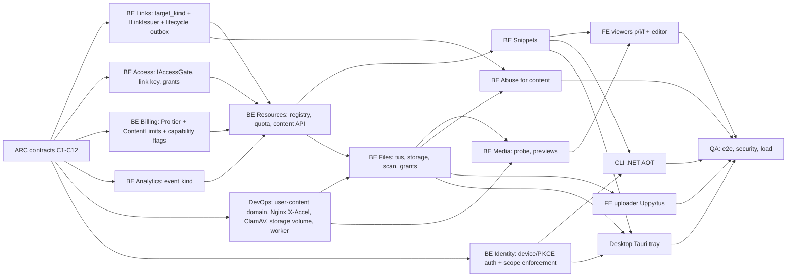

# Phase 1 (micro-sharing): cross-cutting architecture draft

Owner: zaagl-architect. Status: DRAFT for review by the head of tech and the parallel specialist agents.
Scope: E1.1 snippets, E1.2 media drop, E1.3 ephemeral files, E1.4 Tauri tray app (plus the developer CLI).
Evidence was read at `Zaagl-Backend` HEAD `1effe01`. The Phase 0 snapshot was taken at `833963a`, one commit
earlier, so the click-event list and UTM report it marks "Partial" have since been built (commit `1effe01`).
Paths are relative to `Zaagl-Backend/src` unless stated. "spec" means `docs/spec/zaagl-spec-v9.4.md`.

Rules this draft follows: the Phase 0 link engine (leased ranges, keyed scramble, the 5 link states, gates)
is extended, never redesigned. Modules talk only through Contracts. Each shared contract has one owner. Open
product questions are listed in section 7, not decided here.

---

## 1. Phase 0 readiness

### 1.1 Reusable as-is
| Component | Evidence | Why it carries over |
|---|---|---|
| Code issuing (leases + Feistel) | `Zaagl.SharedKernel/ShortCodes/CoordinatorLeaseClient.cs:74-85`, `CodeGenerator.cs:20-52` | Kind-agnostic: it returns a (length, number) pair and a code. |
| Namespace rules | `Modules/Links/Application/SlugRules.cs:11,23-37`; reserved words already include `p`,`f`,`i`,`files`,`snippet(s)`,`raw`,`embed`,`download`,`upload` (`:26,35-36`) | Viewer and raw route names are already protected. |
| Alias safety (freeze, denylist, blocked aliases, advisory lock) | `LinkService.cs:156-203` | Applies unchanged to a custom slug on a content link. |
| Link state function | `Links/Contracts/LinkContracts.cs:181-200` | A total function, so content links get the same 404/410 behaviour. |
| Atomic click limit | `LinkResolver.cs:27-34` (conditional `UPDATE`) | Same pattern serves "max views" and Burn After Downloading. |
| Idempotency keys | `LinkService.cs:74-86,137-147` | Lets a content module retry link creation safely. |
| Cache + `NOTIFY` invalidation | `LinkResolver.cs:17-25`, `LinkService.cs:245-246` | Content links are links, so edits and takedowns invalidate the same way. |
| Analytics pipeline (buffer, partitions, SignalR) | `Analytics/Contracts/AnalyticsContracts.cs:43-55,107-128` | Works once an event kind is added (1.3). |
| Abuse reports by code | `Links/Domain/Link.cs:173-185`, `AbuseControls.cs:204-250` | A report names a code, so content links are covered. |
| Takedown core (disable, block alias, evidence) | `AbuseControls.cs:93-128` | Needs a content hook (1.3), not a rewrite. |
| JWT auth, security stamp, API-key handler | `Zaagl.Api/Program.cs:90-146`, `Infrastructure/ApiKeyAuthentication.cs:22-35` | Unchanged for web clients. |
| Host routing (421) | `Infrastructure/HostRouting.cs:50-61` | Multi-segment `zaa.gl/x/y` paths already go to the short host. |

### 1.2 Unverified, stale or missing
- **PHASE0-HANDOFF.md is stale.** Its section 1 says no SQL has ever run, but commit `acc7e44` is "live-testing
  fixes from full Docker end-to-end verification". `TRACEABILITY.md:5-7` still describes build phase 1. Neither
  document can be used as evidence. Phase 1 QA should rebuild the traceability table.
- **Snapshot vs code on expiry.** The snapshot says "Every link now expires", but `DECISIONS.md:24-28` and the code
  disagree: `LinkService.cs:480-481` sets `PurgeAfter=null` when there is no expiry, and `CreateAsync` never applies
  `DefaultExpiryDays` (that field is used only in `RenewAsync`, `LinkService.cs:538`). Content retention cannot
  rely on link expiry until this is decided (D-6).
- **Redirect rate limiting is missing.** Spec §7.3 asks for 300/min plus tiered miss limits. The `/{slug}` route has
  no `RequireRateLimiting` (`ResolutionEndpoints.cs:16-35`). Only `auth`, `link-write` and `unlock` limits exist, and
  they are in-memory (`Program.cs:69-86`). This matters more once codes protect content (section 2.3).
- **The redirect route accepts 3-character paths.** The regex `{2,63}` after the first character allows length 3
  (`ResolutionEndpoints.cs:16`). Spec §7.3 and §4.5 rule 6 require 1-3 character segments to return 404 before any
  I/O. Harmless today, but those paths are exactly the ones reserved for Phase 1.
- **API-key scopes are never enforced.** Scopes are defined (`IdentityService.cs:39`, `TokenService.cs:60`) and added
  as claims (`ApiKeyAuthentication.cs:32`), but no endpoint checks them (grep: no `RequireClaim` or scope check). A
  `links:read` key can write today. The CLI needs real scopes.
- **API keys are Starter-only** (`IdentityService.cs:395`). Free users cannot use the CLI or desktop app with a key,
  which conflicts with the Phase 1 exit gate "30%+ of active users install the desktop/CLI app" (PRD §5).
- **Wolverine and the worker are not used.** `Zaagl.Worker/Worker.cs:1-16` is the template loop. Purge and
  safety-recheck jobs are `BackgroundService`s inside the API (`PurgeService.cs:26-46`). Scanning, thumbnails and
  file expiry have no home yet.
- **`IFileStorage` exists only as an interface** (`SharedKernel/Storage/IFileStorage.cs:3-8`). It has no
  implementation, no stat, no range read, no temp-to-object move and no internal path for X-Accel-Redirect.
- **Content modules are empty.** Resources, Snippets, Files and Media hold only `.gitkeep` files and reference only
  SharedKernel (their csproj files). The endpoint stubs are empty (`Endpoints/FilesEndpoints.cs:5`, and the same for
  Snippets, Media and Resources). `Program.cs:193-199` does not register those modules.
- **Module boundaries are convention only.** Resolution calls `Links.Application.SlugRules` and the concrete
  `Access.Application.AccessGate` (`ResolutionService.cs:5,7,51`). Access references the whole Links project. No
  NetArchTest rule exists (`DECISIONS.md:100-102`). New content modules must not copy this pattern.
- **Forwarded headers trust any sender** (`Program.cs:51-52` clears `KnownProxies` and networks). This is safe only
  while Nginx overwrites `X-Forwarded-For`. The DNS-only file host has no Cloudflare in front, so the Nginx config
  for that host must set it from `$remote_addr` (ARC-012).

### 1.3 What must change (additive)
1. **The Link model assumes every link is a URL redirect.** URL-only assumptions found in the code:
   - Fields: `Link.DestinationUrl` and `Link.TargetHost` are non-null (`Link.cs:43-47`). `LinkInput.DestinationUrl` is
     required (`LinkInputValidator.cs:12`). `LinkDto`, `LinkSnapshot` and `AdminLinkDto` carry it (`LinkContracts.cs:61-76,203-221,85-88`).
   - Create and update: `Normalize` calls `UrlSafety.TryNormalize` and `new Uri(destination)` (`LinkService.cs:909-952`).
     Web Risk runs on every destination (`:881-889`). The blocklist runs in the transaction (`:150,337,500`). The
     idempotency hash covers the URL (`:471-472`). Library search uses `ILIKE destination_url` (`:620`).
   - Resolution: every allowed request ends in `Redirect(destination)` (`ResolutionService.cs:97-108`). Unlock returns
     a URL (`:79-95`). The crawler preview uses a meta-refresh to the destination (`ResolutionEndpoints.cs:69`). Routing
     rules (`RoutingEvaluator`), `FallbackUrl` and `UtmTags.FromUrl(destination)` (`ResolutionService.cs:106`) are
     URL concepts.
   - Abuse and lifecycle: the safety re-check calls `reputation.CheckAsync(link.DestinationUrl)` (`AbuseControls.cs:187`).
     Evidence stores `TargetUrl` (`:115`). Takedown filters by `TargetHost` (`LinkService.cs:822`). Purge archives
     `DestinationUrl` (`PurgeService.cs:105`). Export emits `TargetUrl` (`LinkContracts.cs:144`).
   - Change: add `target_kind` (`url|snippet|media|file`, default `url`) and `resource_id uuid null`, with a check
     `(target_kind='url') = (resource_id IS NULL)`. Make `destination_url` and `target_host` nullable for content
     kinds. The migration is expand-only and safe because no content rows exist until the new release ships. Every
     URL path above branches on kind. URL behaviour does not change.
2. **Content modules need a create contract.** Today creation is only the concrete `LinkService.CreateAsync(Guid, LinkInput, …)`
   (`LinkService.cs:67`). Add `ILinkIssuer` in `Links.Contracts` (ARC-002).
3. **Gates must be callable outside the redirect.** The viewer API on `api.zaa.gl` can be reached without going
   through `zaa.gl`, so it must evaluate the same gates. Promote `AccessGate` to `Access.Contracts.IAccessGate` and add
   access grants (ARC-004).
4. **Billing hard-codes "paid = Starter".** `PlanTier {Free, Starter}` (`BillingContracts.cs:3-7`). The purge job treats
   only Starter as premium (`PurgeService.cs:102`), so a Pro user's stats would be deleted. API keys check
   `Tier != Starter` (`IdentityService.cs:395`). The webhook always writes Starter (`BillingService.cs:149,164`) from a
   single `StarterPriceId` (`:21,65`). Replace tier-equality checks with capability flags (ARC-005).
5. **The Free monthly cap counts every link** (`LinkService.cs:96-103`, 50/month). Content shares would use up the
   URL quota unless the count filters `target_kind='url'` (D-8).
6. **Analytics has no event type.** `ClickEvent` and `ClickEventRow` hold only redirects (`AnalyticsContracts.cs:43-55`,
   `Analytics/Domain/ClickEventRow.cs:4-28`). Add an event kind (ARC-007).
7. **The safety re-check, purge archive and export must skip or handle content kinds.** Otherwise Web Risk is
   called with a null URL.
8. **The `LinkSnapshot` cache entry shape changes.** Bump the key from `link:{slugKey}` (`LinkService.cs:30`) to a
   versioned key so old L2 (Valkey) entries are not deserialized without `TargetKind`.

---

## 2. Link-to-content resolution

### 2.1 Options
**(a) Link with a content reference.** Each share is a `links.links` row with `target_kind` + `resource_id`. It uses the
existing code issuer, custom aliases, states, password, expiry, limits, analytics, reports and takedown.
- Pros: matches PRD §1.3 ("assets plug into the exact same link engine, security gates, and analytics") and tech stack
  §09 ("Generate the zaa.gl link: same link engine, gates and analytics"). One library and one dashboard. Custom slugs
  (`zaa.gl/pitch-deck`) work for files. No second gate, analytics or takedown implementation.
- Cons: touches the Link model (additive). Codes are about 30 bits and "never an access token" (spec §1, line 15).
  Once the length-5 range fills, about 1 in 100 random 5-character strings is a live code (range_end is 1% of 62^5,
  spec §4.2). Private logs and `.env` snippets (persona Omar) therefore need more than the code (2.3).

**(b) Separate namespaces `zaa.gl/s|i|f/<id>`** (spec §4.5 rule 6). Each module mints long random ids.
- Pros: ids can be 128-bit and unguessable. No Link model change. Matches the spec's literal example.
- Cons: password, expiry, view limits, analytics, reports, takedown, library and quotas would all be rebuilt or
  generalised per module, which goes against the PRD. Custom slugs would not work for content. The tray app would
  have two URL shapes. The frontend already uses `p/` for snippets (`Zaagl-Frontend/src/app/p/[slug]`), not the
  spec's `s/`.

### 2.2 Recommendation: (a), with a hardened delivery path
1. **One namespace.** Every share is a Link. The canonical share URL is `https://zaa.gl/<code-or-alias>`. The
   `zaa.gl/s|i|f/...` prefixes stay reserved and unused in Phase 1. They still return 404 (rule 6). Using them later
   (for example `zaa.gl/f/<code>` as a typed alias of the same Link) is decision D-2.
2. **`zaa.gl` stays a redirector.** For content kinds, `ResolutionService` runs the same gates and then returns
   `302 https://app.zaa.gl/{p|i|f}/<code>`. `zaa.gl` never renders content, never sets cookies, and keeps the §7.3
   headers. Content never runs in the `zaa.gl` origin, which satisfies §1.2 and §4.5 rule 6.
3. **The viewer is trusted UI on `app.zaa.gl`** (Next.js pages already scaffolded: `p/[slug]`, `i/[slug]`, `f/[slug]`).
   It calls `GET api.zaa.gl/api/content/{code}`, which re-runs `IAccessGate` because the viewer can be reached
   directly. User content is shown only as inert data on `app.zaa.gl`: Shiki-escaped code, sanitized Markdown under a
   strict nonce CSP (D-9), ``/`<video>` elements whose `src` is on the user-content domain (SVG inside ``
   cannot run script), and react-pdf with script evaluation off.
4. **Bytes come only from a separate registrable domain** (tech stack §09). Example: `dl.<ucd>` (DNS-only, Nginx with
   X-Accel-Redirect). The API issues short-lived HMAC-signed URLs (`/o/<objectId>?exp&purpose&sig`). Nginx forwards
   the request to an internal ASP.NET authorize endpoint (`auth_request`, or a direct API hop that returns
   `X-Accel-Redirect`). Response headers:
   - Files and "Copy Raw": `Content-Disposition: attachment`.
   - Images and video: inline, with `Content-Security-Policy: sandbox; default-src 'none'; img-src 'self'; media-src 'self'; style-src 'unsafe-inline'`.
   - Always: `X-Content-Type-Options: nosniff`, `Cross-Origin-Resource-Policy: cross-origin`, and the stored MIME type
     (from MimeDetective, never the client's claim).
   - The `<ucd>` host never sets cookies and never receives `app` or `api` credentials.
5. **Unlock returns an access grant instead of a URL.** `POST /api/unlock/{code}` returns a grant token (HMAC: link id,
   resource id, purpose, exp, about 10 minutes) for content kinds. The viewer sends it to the content API. No cookies
   are needed on `api` (§1.2).

### 2.3 Unguessability for non-public content
Because codes are not secrets (§1, §5.3), private content needs a second factor in the URL. Recommended (D-1): a
128-bit **link key** in the URL fragment, `zaa.gl/<code>#k=<22 chars>`. The server stores only its hash, on the
access policy. Under RFC 9110 §10.2.2, browsers keep the fragment across a 3xx redirect when `Location` has none, so
the viewer at `app.zaa.gl/p/<code>#k=…` reads it and sends it in a header. The key never reaches access logs,
`Referer` or crawlers, so secret content does not unfurl, which is intended. The CLI and desktop parse the fragment
themselves. Public content (opt-in) works without a key, like a URL link. The same fragment carries Phase 2
client-side encryption keys (secret vault), so this choice is forward-compatible. The redirect rate limits from
1.2 (ARC-013) are still required.

---

## 3. Module boundaries

```
Links  <-  Resources  <-  Snippets
  ^          ^   ^-----  Files  <-  Media
Access ------+   |
Billing ---------+        (arrows = "references the Contracts of")
Analytics <- Resources, Files (event recording)
```
Links, Access, Billing and Analytics never reference a content module, so the link engine stays untouched.

| Module | Owns (schema `content` per tech stack §05, one sub-area per module) | Exposes (Contracts) | Calls |
|---|---|---|---|
| **Resources** | `resources` (id, owner_id, kind, state `pending→scanning→ready→blocked→deleted`, size_bytes, sha256, retention_until, burn policy, link_id, created_at), `usage_ledger` (bytes reserved/committed per owner), the lifecycle state machine, quota enforcement, retention and deletion orchestration, link binding, `GET /api/content/{code}` dispatch | `ResourceId`, `ResourceKind`, `ResourceState`, `IResourceRegistry` (Register/Bind/MarkReady/MarkBlocked/Delete/GetByLink), `IContentQuota` (Reserve/Commit/Release), `IResourceKindHandler` (implemented by Snippets/Files/Media: `DescribeAsync`, `OnDeletedAsync`), `ContentViewDto` | `ILinkIssuer`, `ILinkResolver`, `IAccessGate`, `IAccessGrants`, `IPlanProvider`, `IClickRecorder` |
| **Snippets** | `snippets`, `snippet_versions` (text in Postgres, language, line count, is_markdown), diff pairs, Markdown render + sanitize (Markdig + HtmlSanitizer), DiffPlex | `SnippetDto`, `SnippetVersionDto`, `CreateSnippetCommand`, `ISnippetReader` (raw text for the raw route) | Resources contracts only |
| **Files** | `objects` (storage key, MIME detected, size, sha256, scan verdict), `upload_sessions` (tus), `download_grants` (single-use, burn counters), `LocalFileStorage`, ClamAV (nClam), signed-URL issuing, X-Accel authorize endpoint, object GC | `IStoredObjects` (Stat/OpenRead/Delete/IssueDownloadUrl), `IUploadSessions` (Create/Finalize), `ObjectId`, `ScanVerdict` | Resources, Access (grants), Analytics |
| **Media** | `media_items` (width, height, colour profile, duration, has_alpha, frame count), derived previews and thumbnails (NetVips/FFmpeg), og:image | `MediaDto`, `IMediaProbe` | Files (`IStoredObjects`), Resources |
| **Links** (extended) | `target_kind`, `resource_id`, content-aware create, lifecycle outbox | `ILinkIssuer`, `LinkTargetKind`, extended `LinkSnapshot`, `ILinkLifecycleEvents` | Billing (existing) |
| **Access** (extended) | link key hash, max views/downloads, grant tokens | `IAccessGate`, `IAccessGrants`, `AccessOutcome` | Links contracts |

Cross-module writes are not atomic. Separate DbContexts already break ACID across schemas (`PurgeService.cs:19-24`).
Order of operations for every share:
1. Resources inserts the resource as `pending` (with quota reserved).
2. `ILinkIssuer.CreateContentLinkAsync`, using the resource id as the Idempotency-Key.
3. Resources binds the link id.

A sweeper deletes `pending` resources older than 24 hours that have no link. Link-side events (deleted, disabled
with kind, expired, purged) reach Resources through a Links-owned **lifecycle outbox** table (`links.lifecycle_outbox`)
drained by the worker. The reverse direction (resource blocked by a scan or hash) calls the existing takedown path
through a new `ILinkTakedown` contract with `DisabledKinds.Safety` or `Abuse` (`Link.cs:13-19`).

---

## 4. Cross-cutting concerns

### 4.1 Plans and quotas
The PRD pricing table: Free 25 MB/file, 7 days; Starter 100 MB/file, 30 days; Pro 5 GB/file, permanent; Team
unlimited or BYO bucket. Billing has only Free and Starter (`BillingContracts.cs:3-34`). Gaps:
- No `Pro` tier, no second Stripe price, and the webhook cannot tell prices apart (`BillingService.cs:139-169`).
- `PlanLimits` has no content fields. Proposed addition: `ContentLimits(long MaxFileBytes, int? RetentionDays,
  long? StorageQuotaBytes, int? MaxSharesPerDay, bool BurnAfterDownload, bool PasswordOnContent)`, plus capability
  flags `IsPaid`, `ApiKeys` and `KeepStatsAfterPurge`, so no caller compares tiers again.
- The PRD gives no total-storage cap, but its own risk register ("Cloud storage cost bloat") and tech stack §16 ask
  for quotas. Each tier needs a storage quota (D-4).
- Guests: content creation should be disabled (PRD risk register: "Require account login"). `PlanLimits.Guest`
  (`BillingContracts.cs:33`) gets `ContentLimits.None`.
- Downgrade: existing content keeps its frozen `retention_until`. New uploads use the new tier. This repeats the
  open Phase 0 downgrade edge case (PHASE0-HANDOFF §2) (D-7).
- Usage accounting must be durable and transactional (tech stack §12: "billing-related usage … must use durable
  processing"). Reserve at upload start, commit at finalize, release on delete or abort.

### 4.2 Retention vs link expiry
- Content retention is the binding limit. For content kinds, the link's `ExpiresAt` is set to
  `min(requested, created + plan.RetentionDays)` and is mandatory, except Pro "permanent" = null (D-6).
- Bytes are deleted at `expires_at`, not at `purge_after`. The link row still goes through the normal 90-day
  quarantine (410 "This pigeon has flown"), which keeps the alias protected. A quarantined content link cannot be
  renewed because its bytes are gone. Renewal is allowed only while the link is active and only up to the plan cap.
- Burn After Downloading: the first successful download grant atomically sets `downloads_used` (same conditional
  `UPDATE` as `LinkResolver.cs:30-33`) and sets link `ExpiresAt = now`. The link then enters quarantine without a new
  state, and the object is queued for deletion. "One download" means one grant, valid about 10 minutes with HTTP
  Range resume allowed (D-5).
- Purge order: link purge emits `LinkPurged` and Resources deletes any leftovers (idempotent).

### 4.3 Abuse and takedown for content
- Hosted content brings new abuse vectors: phishing pages (Markdown snippets, PDFs, SVG), malware (ZIP/EXE), CSAM
  and copyright. Controls:
  - ClamAV before `ready`.
  - A SHA-256 hash blocklist (`content.blocked_hashes`), checked at finalize and re-checked on admin add.
  - Web Risk on URLs extracted from snippets and Markdown, within the same budget as Phase 0.
  - Markdown links rendered with `rel="nofollow ugc noopener"`. No raw HTML snippets.
  - The PDF viewer runs with JS evaluation off.
  - Takedown sets link `DisabledKind=abuse|safety` (existing behaviour) and moves the object to `storage/quarantine`
    with a legal hold (`keep_until` = `Abuse:EvidenceRetentionDays`) instead of deleting it.
  - `AbuseEvidence` gains `resource_id`, `sha256` and `object_key`, because `TargetUrl` is meaningless for content
    (`AbuseControls.cs:113-121`).
  - The safety re-check must filter `target_kind='url'` (`AbuseControls.cs:187`).
  - Bulk takedown gains filters by `sha256` and `target_kind`.
- EU hosting means DSA notice-and-action and a CSAM process. These are legal open questions (D-11).

### 4.4 Analytics events
Add `kind smallint not null default 0` to `ClickEvent`, `click_events` and `link_daily_stats` (expand-only;
`click_events` indexes must be built per partition, spec §3). Kinds:

| Kind | When |
|---|---|
| 0 `redirect` | Existing behaviour at `zaa.gl`. |
| 1 `view` | Viewer metadata fetched by a non-bot. |
| 2 `raw` | Raw text served. |
| 3 `download` | Download grant issued. |

The public stats page and per-link analytics break down by kind. "Clicks" in the library = `redirect + view`,
de-duplicated per visitor hash and day (D-10). Download counts used for burn or billing must come from the durable
grant table, never from the buffered pipeline. Guest rules are unchanged.

### 4.5 Rate limits and bandwidth
New policies, Valkey-backed before horizontal scale (`docs/SCALING.md`):
- `content-write` per user.
- `upload-session` per user.
- `download-grant` per IP partition + link.
- Nginx `limit_rate` / `limit_conn` on `dl.<ucd>` (no Cloudflare in front).
- The missing §7.3 redirect and miss limits, which now also protect content codes.

---

## 5. Workstream dependency graph and shared contracts



Contracts to agree before parallel implementation, each with one owner:

| ID | Contract | Owner | Consumers |
|---|---|---|---|
| C1 | `LinkTargetKind`, `ILinkIssuer.CreateContentLinkAsync(ContentLinkRequest)`, extended `LinkSnapshot`/`LinkDto` (`TargetKind`, `ResourceId`, nullable `DestinationUrl`) | Links (backend) | Resources, Resolution, FE |
| C2 | `ResourceId/Kind/State`, `IResourceRegistry`, `IResourceKindHandler`, `IContentQuota` | Resources | Snippets, Files, Media |
| C3 | Host and URL scheme: `zaa.gl/<code>` → `app.zaa.gl/{p,i,f}/<code>`; user-content domain names; signed-URL format | Architect + DevOps | all |
| C4 | `IAccessGate`, `IAccessGrants`, grant token format, link-key fragment `#k=` and header name | Access | Resolution, Resources, Files, FE, CLI, Desktop |
| C5 | `PlanLimits` + `ContentLimits` + capability flags; Pro tier | Billing | all backend |
| C6 | Analytics `EventKind` and recording rules | Analytics | Resolution, Resources, Files, FE |
| C7 | `IFileStorage` v2 (`SaveAsync` to temp, `PromoteAsync`, `StatAsync`, `OpenReadAsync(range)`, `GetInternalPath` for X-Accel, `DeleteAsync`) | Files | Media, DevOps |
| C8 | Upload protocol: tus 1.0 endpoint, `Upload-Metadata` keys, chunk size, finalize → link response | Files | FE, CLI, Desktop |
| C9 | Public content REST API (OpenAPI): create snippet, create upload, get content, get raw, unlock, list "my content" | Architect (review) / module owners | FE, CLI, Desktop, QA |
| C10 | Lifecycle events (`LinkDeleted`, `LinkDisabled{kind}`, `LinkExpired`, `LinkPurged`, `ResourceBlocked`) + outbox schema | Links + Resources | Files, Media, Abuse |
| C11 | Client auth for CLI/desktop (device-code or PKCE loopback, refresh rotation, scopes `content:write`, `content:read`) | Identity | CLI, Desktop |
| C12 | Content abuse: hash blocklist, evidence fields, takedown kinds and filters | Links (abuse) + Files | Admin, QA |

---

## 6. Architecture tasks

**ARC-001 · Phase 1 contract pack and ADR set** · P0 · deps: none
Write C1-C12 as C# Contracts stubs (types and interfaces only, no logic) plus one ADR each for D-1 to D-12 once decided.
Acceptance: each contract has an owner and is reviewed by the consuming agents. Stubs compile. No module references
another module's non-Contracts namespace.
Deliverables: `docs/phase1-implementation/contracts.md`, `docs/phase1-implementation/adr/*.md`, PR stubs per module.

**ARC-002 · Link target model (content links)** · P0 · deps: ARC-001
Specify the `target_kind`/`resource_id` columns, the nullable destination, the check constraint, the expand-only
migration, a branch at every URL-only site listed in 1.3, `ILinkIssuer`, and the versioned cache key.
Acceptance: all Phase 0 tests pass unchanged. A content link can be created, renewed, deleted and disabled. Web Risk,
the blocklist, routing rules and UTM are skipped for content kinds. The library search does not fail on a null destination.
Deliverables: design note + review checklist for the backend agent.

**ARC-003 · Resolution flow for content kinds** · P0 · deps: ARC-002, ARC-004
Specify: `ResolveKind.Content` → 302 to the viewer; the crawler preview for public content only (og:image = media
preview on `<ucd>`); 404 for 1-3 character and multi-segment paths before I/O; fix the route regex at
`ResolutionEndpoints.cs:16`.
Acceptance: tests show that `zaa.gl` never sets `Set-Cookie`, never serves content bytes, and returns 404 for `/ab`
and `/f/x` in Phase 1.
Deliverables: sequence diagrams (redirect, unlock, view, download).

**ARC-004 · Access gate as a contract + grants + link key** · P0 · deps: ARC-001
Move to `IAccessGate` in `Access.Contracts`. Add link key hash, `MaxViews`, `MaxDownloads` and an HMAC grant token
(purpose-bound, about 10 minutes, rotating key set like JWT).
Acceptance: the viewer API refuses requests without a valid gate pass. Grants cannot be replayed across links or
purposes. Concurrent burn gives exactly one grant (Testcontainers race test).
Deliverables: token spec, threat model.

**ARC-005 · Plan model v2 (Pro + ContentLimits + capability flags)** · P0 · deps: D-3, D-4
Add Pro. Map Stripe price to tier. Replace `Tier == Starter` at `PurgeService.cs:102`, `IdentityService.cs:395` and
`BillingService.cs:58,149,164` with flags. Add content limits.
Acceptance: Pro users keep stats after purge, can create API keys, and get 5 GB uploads. No `PlanTier.` equality
remains outside Billing (grep test).
Deliverables: contract + migration plan + Stripe config list.

**ARC-006 · Resource lifecycle and quota state machine** · P0 · deps: ARC-002, ARC-005
Define states and transitions, the reserve/commit/release ledger, the orphan sweeper, retention deletion, burn, and
reactions to C10 events.
Acceptance: every transition is listed with its trigger and side effects. Quota never goes negative or past the cap
under concurrent uploads (race test). An orphan pending resource is gone within 24 hours.
Deliverables: state diagram + table.

**ARC-007 · Analytics event kinds** · P1 · deps: ARC-001
Specify the `kind` column on events and daily stats (partition-safe indexes), dashboard semantics and the
public-stats breakdown.
Acceptance: Phase 0 dashboards show identical numbers for URL links. Content links show views and downloads separately.
Deliverables: schema note + metric definitions.

**ARC-008 · User-content domain and delivery path** · P0 · deps: D-1, D-2
Specify domain names, DNS-only vs proxied, the Nginx `internal` location, the authorize hop, the signed-URL format,
response headers (2.2.4), CORS for react-pdf fetches from `app.zaa.gl`, and Range support.
Acceptance: a security test suite proves `<ucd>` responses never set cookies, always send nosniff and the CSP
sandbox, that SVG and HTML cannot execute script when opened directly, and that an expired or tampered signature
returns 403.
Deliverables: host table, Nginx reference config for DevOps.

**ARC-009 · Upload pipeline (tus → temp → scan → promote)** · P0 · deps: ARC-006, ARC-008, D-12
Cover endpoint host, chunk size (≤ 90 MB if the request passes through Cloudflare), auth on tus, MIME sniffing, ClamAV
timeouts and fail-closed behaviour, the promote step, and when the link is issued relative to the scan.
Acceptance: a 5 GB resumable upload survives an API restart. An infected file never reaches `ready`. The link is
returned within 1 second of finalize for the desktop app.
Deliverables: sequence diagram, failure matrix.

**ARC-010 · Snippet model and rendering safety** · P1 · deps: ARC-006, D-9
Cover versions and diff semantics, size cap, language auto-detection order (tech stack §14), and Markdown sanitize
plus CSP on `app.zaa.gl`.
Acceptance: an XSS corpus (OWASP cheat sheet + Markdown-specific vectors) produces no script execution on the viewer.
The raw route is served from `<ucd>` as `text/plain; charset=utf-8` attachment-or-inline per D-9.
Deliverables: design note, test corpus list.

**ARC-011 · Media fidelity and processing** · P1 · deps: ARC-009, D-13
Store original bytes untouched. Make derived previews only for thumbnails and og:image. Cover EXIF/GPS policy,
colour profiles, the video playback fallback, and worker concurrency limits.
Acceptance: the downloaded original is byte-identical to the upload (sha256), unless the user opted into stripping
location data. Previews never replace originals in the viewer at 100% zoom.
Deliverables: design note.

**ARC-012 · Worker and job hosting decision (Wolverine)** · P1 · deps: none
Decide what moves from the API `BackgroundService`s to `Zaagl.Worker`. Define outbox drains, scan, thumbnail,
expiry and GC jobs, concurrency limits, and the forwarded-header rule for the DNS-only host.
Acceptance: redirects keep priority (tech stack §11). Jobs are idempotent and restart-safe.
Deliverables: ADR + job catalogue.

**ARC-013 · Rate limiting v2** · P1 · deps: ARC-008
Add the spec §7.3 redirect and miss limits that are missing today. Add content-write, upload and download-grant
policies, Valkey-backed counters and Nginx bandwidth limits.
Acceptance: an enumeration test is throttled per IP partition. Download limits hold on the DNS-only host.
Deliverables: policy table.

**ARC-014 · Client auth for CLI and desktop + scope enforcement** · P0 · deps: D-3
Cover device-code or PKCE loopback, token storage in the OS keychain (Tauri `keyring`), new scopes and enforcement on
every endpoint group, and Free-tier access.
Acceptance: a `links:read` key gets 403 on writes. A Free user can sign in from the CLI and the tray app.
Deliverables: auth flow ADR + endpoint/scope matrix.

**ARC-015 · Content abuse and takedown** · P1 · deps: ARC-002, ARC-009
Cover the hash blocklist, evidence fields, quarantine and legal hold, the safety re-check kind filter, report UI on
viewers, and admin views by kind.
Acceptance: taking down a content link makes its bytes unreachable within 15 seconds (cache invalidation + grant
refusal) and keeps the evidence.
Deliverables: runbook additions to `docs/ABUSE.md` (via the owner).

**ARC-016 · Public content API (OpenAPI) review** · P0 · deps: ARC-002, ARC-004, ARC-006
One OpenAPI document shared by FE, CLI and desktop. Error codes reuse `ApiResults`. Covers idempotency on create and
pagination for "my content".
Acceptance: generated clients for TypeScript and .NET compile. Contract tests run in CI.
Deliverables: `openapi` diff + review notes.

**ARC-017 · Architecture tests** · P2 · deps: ARC-001
Add NetArchTest rules: modules reference only other modules' `.Contracts` namespaces. Fix the existing violations
(`ResolutionService.cs:5,7`).
Acceptance: a CI failure on any new cross-module non-Contracts reference.
Deliverables: test project.

**ARC-018 · Capacity and retention model** · P2 · deps: ARC-005
Estimate disk use from the quotas (tech stack §16: 1-2 TB NVMe), set thresholds that pause uploads near disk-full,
and confirm the backup scope (Restic/Borg) covers objects but not temp.
Acceptance: an alert and automatic upload pause at the configured free-space floor.
Deliverables: sizing sheet.

---

## 7. Open decisions

**D-1 Secrecy of content links.** Options: (i) the code alone, like URL links; (ii) a 128-bit key in the URL fragment;
(iii) a key in the path (`zaa.gl/<code>/<key>`); (iv) the long-id namespace `zaa.gl/f/<id>`.
*Recommend (ii)*, on by default for snippets and files, opt-out ("public") for images. Codes are not secrets (spec §1).

**D-2 Use of the reserved `s|i|f` prefixes.** Options: leave them unused; typed aliases `zaa.gl/f/<code>`; separate
namespaces. *Recommend leaving them unused in Phase 1* (404 per rule 6). Also align the viewer route names: the frontend
uses `p/`, the spec's example uses `s/`. Choose one before the frontend ships.

**D-3 Who can use the CLI and desktop app.** Options: paid API keys only; any account via device/PKCE auth.
*Recommend any account*, otherwise the "30% install" exit gate cannot be met. Keep API keys paid for automation.

**D-4 Tier matrix.** Is Starter's 100 MB/30 days final? What are the total storage quotas (proposed: Free 250 MB,
Starter 5 GB, Pro 100 GB)? Does Pro "permanent" mean no expiry at all, or an expiry renewable without limit? Is Pro
sold in Phase 1, given the exit gate "3% free-to-Pro conversion"? *Recommend* adding Pro in Phase 1 with explicit
storage quotas, and making "permanent" mean "no expiry while the subscription is active, plus 30 days of grace after
a downgrade".

**D-5 Burn After Downloading semantics.** Options: burn at grant issue; burn at the first completed byte range (Nginx
log); burn at the first view. *Recommend at grant issue*, with Range resume inside the grant TTL. Bots and unfurlers
never get grants. The owner's own preview does not burn.

**D-6 Expiry model.** Should Phase 0 links get mandatory expiry (spec §1.1) or stay optional (`DECISIONS.md:24`)?
*Recommend* mandatory expiry for content kinds (plan retention) whatever is decided for URLs. Settle the
snapshot/code conflict separately.

**D-7 Downgrade behaviour.** Options: delete over-quota content; freeze existing retention and block new uploads;
read-only grace. *Recommend* freezing existing `retention_until` and blocking new uploads while over quota.

**D-8 Quota accounting for shares.** Do content shares count toward Free's 50 links/month? *Recommend not*: count only
`target_kind='url'` and give content its own daily share limit plus a storage quota.

**D-9 Markdown and raw rendering location.** Options: sanitized HTML inline on `app.zaa.gl` under a strict CSP;
sandboxed iframe from `<ucd>`; plain text only. *Recommend* sanitized inline HTML with a nonce CSP and remote images
blocked or proxied (tracking pixels). Raw is served from `<ucd>` as `text/plain`, never `text/html`.

**D-10 What a "click" means for content.** Options: count redirects only; count viewer opens; count both.
*Recommend* a headline "views" (redirect + direct viewer opens, de-duplicated by visitor/day) plus a separate
"downloads" count.

**D-11 Legal and abuse obligations for hosting (EU).** DSA notice-and-action contact, CSAM hash-matching provider,
copyright procedure, evidence retention period. *Recommend* a legal review before public launch of uploads. Do not
build a CSAM scanner in-house.

**D-12 Upload host.** Options: tus on `api.zaa.gl` through Cloudflare with chunks of 90 MB or less (origin hidden for
uploads, WAF applies); tus on the DNS-only `<ucd>` host (one host for all large traffic). *Recommend* `api.zaa.gl`
with chunking, and downloads only on the DNS-only host. Revisit if throughput suffers.

**D-13 Media fidelity vs privacy.** Options: keep all metadata (100% original); strip GPS by default; strip all EXIF.
*Recommend* keeping bytes untouched by default with a prominent "remove location data" toggle, on by default in the
desktop app's clipboard share. Never re-encode pixels.

**D-14 Guest content.** *Recommend* no guest uploads or snippets in Phase 1 (PRD risk register: "Require account login").

**D-15 Storage backend.** The PRD risk register names Cloudflare R2 (zero egress). The tech stack chose local disk
behind `IFileStorage`. *Recommend* local disk per the tech stack, with C7 designed so an R2/S3 implementation
(pre-signed URLs instead of X-Accel) is a drop-in. Record the PRD conflict in DECISIONS.
