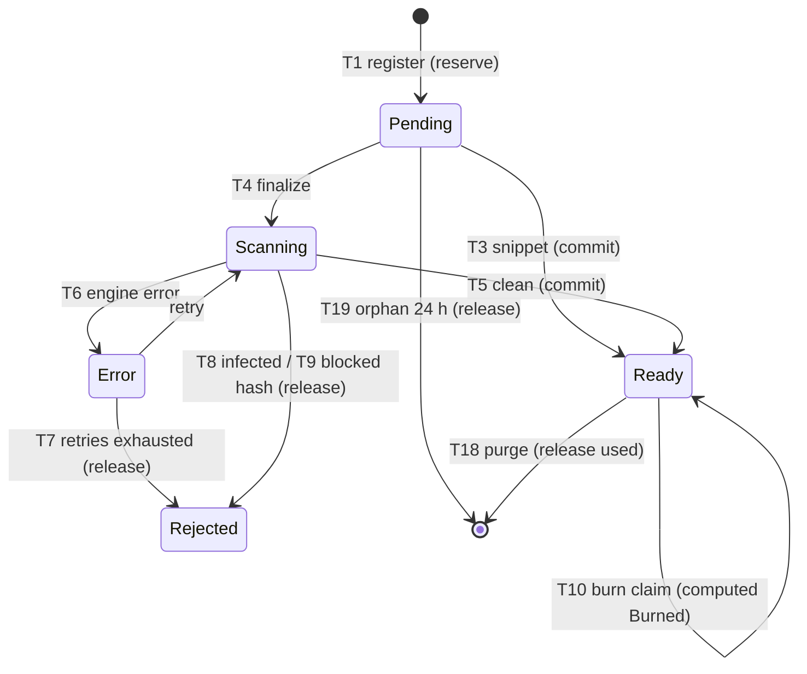

# ARC-006 · Resource lifecycle and quota state machine

| | |
|---|---|
| Owner | zaagl-architect. Implementer: backend (BE-006 Resources; Files and Snippets for their handlers). |
| Status | DESIGN, ready to implement. Contract C2 frozen (`src/Modules/Resources/Contracts/ResourceContracts.cs`), C10 frozen (`src/Modules/Links/Contracts/ContentLinkContracts.cs`). |
| Rules | Addendum §2.2-2.4, §6, §7, §8, §9, §10.3, §11, §13. PD-04, PD-05, PD-06 (as changed), PD-14 (as updated), PD-15, PD-28, PD-54, PD-55, APPROVED. |
| Jobs | Hosting and schedules: design/ARC-012-job-hosting.md (PD-25 APPROVED). Byte deletion is Files' `delete-bytes` task. |

## 1. Tables (schema `resources`, owned by Resources)

```sql
CREATE TABLE resources.resources (
  id uuid PRIMARY KEY,                       -- UUIDv7
  public_id text NOT NULL UNIQUE,            -- 16 CSPRNG bytes, base64url (22); tickets only, never in share URLs
  kind smallint NOT NULL CHECK (kind IN (1,2,3)),          -- mirrors LinkTargetKind
  owner_id uuid NULL, guest_creator_key bytea NULL,
  CHECK ((owner_id IS NULL) <> (guest_creator_key IS NULL)),
  link_id uuid NULL UNIQUE,                  -- set once by BindLink; never changes
  title text NULL,
  declared_size_bytes bigint NOT NULL CHECK (declared_size_bytes >= 0),
  size_bytes bigint NULL,                    -- final, set at ready
  processing_status smallint NOT NULL DEFAULT 0,          -- ProcessingStatus
  rejected_reason text NULL,                 -- RejectedReasons
  burn_after_download boolean NOT NULL DEFAULT false,
  burn_claimed_at timestamptz NULL, burn_grant_id uuid NULL,
  deleted_at timestamptz NULL,               -- owner delete mirrored from LinkDeleted
  link_expires_at timestamptz NOT NULL,      -- copy of the link's dates, kept current by C10 handlers;
  link_purge_after timestamptz NOT NULL,     -- used by sweeps and as the burn-claim expiry guard (§5); never for state
  bytes_state smallint NOT NULL DEFAULT 0,   -- 0 none yet, 1 stored, 2 quarantined (legal hold), 3 deleted
  legal_hold_until timestamptz NULL,
  reservation_id uuid NULL,
  created_via smallint NOT NULL, created_at timestamptz NOT NULL, updated_at timestamptz NOT NULL
);
CREATE INDEX ON resources.resources (owner_id, created_at DESC) WHERE owner_id IS NOT NULL;
CREATE INDEX ON resources.resources (created_at) WHERE link_id IS NULL;              -- orphan sweeper

CREATE TABLE resources.quota_ledger (
  owner_id uuid PRIMARY KEY,
  used_bytes bigint NOT NULL DEFAULT 0 CHECK (used_bytes >= 0),
  reserved_bytes bigint NOT NULL DEFAULT 0 CHECK (reserved_bytes >= 0),
  updated_at timestamptz NOT NULL
);
CREATE TABLE resources.quota_reservations (
  id uuid PRIMARY KEY, owner_id uuid NOT NULL, resource_id uuid NULL,
  bytes bigint NOT NULL CHECK (bytes >= 0),
  state smallint NOT NULL,                   -- 0 reserved, 1 committed, 2 released
  created_at timestamptz NOT NULL, settled_at timestamptz NULL
);
CREATE TABLE resources.quota_usage (           -- one row per resource whose bytes count as used
  resource_id uuid PRIMARY KEY, owner_id uuid NOT NULL,
  bytes bigint NOT NULL CHECK (bytes >= 0),
  released_at timestamptz NULL
);
CREATE TABLE resources.download_grants (
  id uuid PRIMARY KEY, resource_id uuid NOT NULL REFERENCES resources.resources(id),
  purpose smallint NOT NULL,                 -- DeliveryPurpose
  minted_at timestamptz NOT NULL, first_use_by timestamptz NOT NULL,   -- mint + Content:DownloadTicketSeconds
  first_used_at timestamptz NULL, request_count int NOT NULL DEFAULT 0,
  is_burn_claim boolean NOT NULL DEFAULT false
);
CREATE INDEX ON resources.download_grants (resource_id);
```

Guests (`owner_id IS NULL`) have no ledger: `StorageQuotaBytes` is null for the guest plan (ARC-005), and guest volume
is limited by the PD-14 creation counters. `IContentQuota.ReserveAsync` for a guest owner writes nothing and returns
a synthetic `QuotaReservation` (`ReservationId = Guid.Empty`, `Bytes = declared`); commit and release are no-ops for
guests. The per-file cap still applies (C5).

## 2. State

Stored: `processing_status`, `burn_claimed_at`, `deleted_at`, `bytes_state`. Computed, never stored:
`ResourceStateCalculator.Compute(LinkState? linkState, ResourceRow r, now)`, first match wins (addendum §2.4):

| # | `ResourceState` | Condition |
|---|---|---|
| 1 | `Purgeable` | link state `Purgeable` (or no link found) |
| 2 | `Deleted` | link state `Deleted` or `r.deleted_at` set |
| 3 | `Disabled` | link state `Disabled` |
| 4 | `Burned` | `r.burn_claimed_at` set |
| 5 | `Expired` | link state `Quarantined` |
| 6 | `Processing` | `processing_status` in `Pending, Scanning, Error` |
| 7 | `Rejected` | `processing_status = Rejected` |
| 8 | `Ready` | otherwise |

`linkState` comes from `AccessGateResult.LinkState` on public routes and from the snapshot on owner routes. Bytes are
served only in `Ready`, plus the burn grace of the claiming grant in state 4 (§5).

## 3. Transitions

`S` = `processing_status`. Every row change uses a conditional `UPDATE ... WHERE <guard>`; zero rows means the
transition already happened or is not allowed (idempotent, no exception).

| # | Trigger | Guard | Effect | Quota | Bytes | Link / events |
|---|---|---|---|---|---|---|
| T1 | `RegisterAsync` (snippet create, upload complete) | plan checks passed (C5) | insert `S=Pending`, `link_expires_at/purge_after` from the clamped expiry | `Reserve(declared)` in the same transaction | none | none |
| T2 | `BindLinkAsync` | `link_id IS NULL` | set `link_id` | none | none | after `ILinkIssuer` (idempotency key = resource id); the link is returned and shareable at once, before the scan (PD-28 APPROVED); it serves no byte until `Ready` |
| T3 | snippet stored (Snippets, same request) | `S=Pending` | `S=Ready`, `size_bytes` | `Commit(actual)` | text in `snippets` | none |
| T4 | `MarkScanningAsync` (upload finalized, Files) | `S=Pending` | `S=Scanning` | none | temp | none |
| T5 | scan clean + promote (`MarkReadyAsync`) | `S IN (Scanning, Error)` | `S=Ready`, `size_bytes`, `bytes_state=1` | `Commit(actual)`; `actual > reserved` → `MarkRejected(too-large)` | objects | none |
| T6 | scan engine error | `S=Scanning` | `S=Error`, attempt counted (Files task) | none | temp | none |
| T7 | retries exhausted | `S=Error` | `S=Rejected`, `scan-unavailable` | `Release` | `delete-bytes` (temp) | none (not malware) |
| T8 | infected | `S IN (Scanning, Error)` | `S=Rejected`, `infected`, `bytes_state=2`, `legal_hold_until` | `Release` | move to quarantine | `ILinkTakedown(Safety)` |
| T9 | hash on blocklist (finalize, or later sweep) | any | `S=Rejected`, `blocked-hash`, `bytes_state=2` | `Release` or `ReleaseUsed` | quarantine | `ILinkTakedown(Abuse)` |
| T10 | burn claim (§5) | `Ready`, burn, not claimed, link active | `burn_claimed_at`, `burn_grant_id` | none yet | served to the claiming grant only | none |
| T11 | burn finaliser | claimed and (now ≥ claim + `Burn:GraceMinutes` or `request_count ≥ Burn:MaxRequests`) | `bytes_state=3` | `ReleaseUsed` | `delete-bytes` | link stays; viewer shows "downloaded and deleted" |
| T12 | `LinkExpired` (account) | none | none | none | **kept** (PD-06) | state `Expired` by computation |
| T13 | `LinkExpired` (guest, `IsGuest`) | `bytes_state IN (0,1)` | `bytes_state=3` | none (no ledger) | `delete-bytes` now | link purgeable (`purge_after = expires_at`) |
| T14 | `LinkRenewed` | not burned, not deleted | update `link_expires_at`, `link_purge_after` | none | kept | none |
| T15 | `LinkDeleted` | none | `deleted_at` | none now; `ReleaseUsed` at purge (T18), PD-55 | unreachable now; kept through the 90-day quarantine, deleted at `link_purge_after` (PD-55) | none |
| T16 | `LinkDisabled` abuse/safety | `bytes_state=1` | `bytes_state=2`, `legal_hold_until = now + Abuse:EvidenceRetentionDays` (hold length PD-11 OPEN) | **pending Q2**: `ReleaseUsed` now (recommended) or at T21; until answered, none (fail-safe: keeps counting) | move to quarantine | evidence row (C12) |
| T17 | `LinkDisabled` admin/user, `LinkEnabled` | none | none (state computed) | none | kept | after an abuse/safety reinstate: `bytes_state=2 → 1` (move back) only if `legal_hold` allows; else the link stays without bytes (Q3) |
| T18 | `LinkPurged` | none | `IResourceKindHandler.OnResourceDeletedAsync`; row kept as tombstone 30 days then deleted | `ReleaseUsed`, `Release` if still reserved | `delete-bytes` unless `bytes_state=2` (legal hold wins) | none |
| T19 | orphan sweeper | `link_id IS NULL AND created_at < now - 24 h` | kind handler delete, row delete | `Release` | `delete-bytes` (temp) | none |
| T20 | upload session expired (Files) | session idle 24 h, no resource yet | none on resources | `Release` | temp deleted | none |
| T21 | legal hold ended | `bytes_state=2 AND legal_hold_until < now` | `bytes_state=3` | none | `delete-bytes` (quarantine) | evidence rows kept |

Account bytes are deleted at `purge_after` (PD-06), guest bytes at `expires_at`, burn bytes at the end of the grace,
taken-down bytes when the legal hold ends. "Bytes still on disk 15 minutes after their deletion time" is an alert
(addendum §9.6): the `delete-bytes` task carries `due_at`, and a metric counts tasks with `due_at < now - 15 min`.



## 4. Quota ledger (`IContentQuota`)

Every method runs in one transaction that first takes
`SELECT pg_advisory_xact_lock(hashtextextended('zaagl.quota:' || @ownerId::text, 0))` and
`SET LOCAL lock_timeout = '3s'` (spec §7.0; `55P03` → `503 busy`, `Retry-After: 1`).

- Reserve(owner, bytes): `INSERT INTO quota_ledger (owner_id, updated_at) VALUES (...) ON CONFLICT DO NOTHING`; then
  `UPDATE quota_ledger SET reserved_bytes = reserved_bytes + @b WHERE owner_id = @o AND used_bytes + reserved_bytes +
  @b <= @quota RETURNING ...`. Zero rows → `403 quota-exceeded`. Insert the reservation (`state=0`). The conditional
  update is the guard; the advisory lock serialises the owner's reservation with commit and release.
- Commit(reservation, actual): reservation `state=0` → 1; ledger `reserved -= r.bytes`, `used += actual`; insert
  `quota_usage(resource_id, owner, actual)`. A replay finds `state=1` and does nothing. `actual > r.bytes` is refused
  (tus `Upload-Length` is exact, so it means a bug) → T5 rejects `too-large`.
- Release(reservation): `state=0` → 2; `reserved -= r.bytes`. Other states: no-op.
- ReleaseUsed(resource): `quota_usage.released_at IS NULL` → set; `used -= bytes`. No row or already released: no-op.
- GetUsage(user): ledger row or zeros, plus `StorageQuotaBytes` from C5 (`GET /api/me/storage`).

Invariants (tested later, QA deferred by PD-51): `used + reserved ≤ quota` after any reserve; never negative (CHECK);
`used_bytes = Σ quota_usage.bytes WHERE released_at IS NULL`; `reserved_bytes = Σ reservations WHERE state = 0`. The
daily reconciliation task (ARC-012) recomputes both sums under the lock, fixes drift and alerts on any. A quota lowered
by a downgrade is never applied retroactively: only new reservations see it (ARC-005 §7).

Order for a share (addendum §2.2): T1 in Resources' transaction (row + reservation), then `ILinkIssuer` (own
transaction, idempotent by resource id), then T2. A crash between steps is repaired by retrying the same request
(idempotency keys at the API edge) or by the orphan sweeper (T19).

## 5. Burn After Downloading (PD-05)

1. Mint (`POST /api/public/content/{code}/download`, after the gate with purpose `Download`): requires `Ready`;
   insert a grant `purpose = Download`, `first_use_by = now + Content:DownloadTicketSeconds`; return the ticket URL.
   Minting consumes nothing. Burn files never get `Inline`/`Preview`/`Raw` grants.
2. First GET of that ticket (authorize hop, `isHead = false`), one transaction:
   ```sql
   UPDATE resources.resources SET burn_claimed_at = @now, burn_grant_id = @grant, updated_at = @now
   WHERE id = @rid AND burn_after_download AND burn_claimed_at IS NULL AND processing_status = 2 AND deleted_at IS NULL
     AND link_expires_at > @now;
   UPDATE resources.download_grants SET first_used_at = @now, request_count = 1, is_burn_claim = true
   WHERE id = @grant AND first_used_at IS NULL AND @now < first_use_by;
   ```
   Both must affect one row, else roll back.
   **Claim rule (stated only here; ARC-008 §6 and contracts.md C2 point to it).** Addendum §8.2.2 requires the link to
   be not expired, deleted or disabled at claim time. The authorize hop computes the resource state (addendum §2.4,
   link state from the snapshot) just before; the claim statement repeats the time-based part itself with
   `AND link_expires_at > @now` (and `deleted_at IS NULL`), so a link that expires between the check and the claim is
   **refused**, not served. A disable racing the claim is caught on the next request: `Disabled` ranks above `Burned`
   (§2), so the claiming grant gets nothing further. Exactly one concurrent request wins because the first `UPDATE`
   holds the row lock; the others see `burn_claimed_at` set → `410 burned`.
   After the claim, link expiry no longer stops the grace downloads (`Burned` ranks above `Expired`, §2).
3. Further requests of the claiming grant: `UPDATE download_grants SET request_count = request_count + 1 WHERE id =
   @grant AND is_burn_claim AND request_count < @max AND @now < @claim + @grace` → one row: allowed; zero: `410 burned`.
4. `HEAD`: validates the ticket and returns the headers, never claims and never counts.
5. Non-burn download grants: the addendum fixes only "120 s after minting if unused" (§8.1.2); how long a used
   ticket may keep serving `Range` parts is not specified. Technical default (not a product rule): the same numbers as
   the burn grace, 30 minutes and 16 requests after the first GET, so multi-part delivery works (ARC-008).
   Configuration `Content:DownloadGrantReuseMinutes`, `Content:DownloadGrantMaxRequests`.
6. Owner downloads (`purpose = Owner`) never touch burn columns.
7. After a claim: `PATCH` burn off → `409 burn-already-claimed`; renew → `409 burn-already-claimed`; the descriptor
   and the redirect show state `Burned` (`410`).

## 6. C10 handler (Resources implements `ILinkLifecycleHandler`)

At least once, any order per link is possible across retries, so every reaction is guarded by the current row:
`LinkRenewed` applies only if its `ExpiresAt` is later than the stored copy; `LinkExpired` for a renewed link (stored
`link_expires_at > event.OccurredAt`) is ignored; `LinkPurged` is final. Reactions: T12-T18. The handler never calls
back into Links in the same transaction.

## 7. Review checklist (BE-006)

- [ ] Every transition is a guarded conditional update; a replay changes nothing.
- [ ] Quota operations take the owner advisory lock; CHECK constraints present; guests write no ledger rows.
- [ ] Concurrent reservations for one owner never exceed the quota (race test written later, QA deferred).
- [ ] Burn: exactly one winner under concurrency; HEAD never claims; grace and max requests enforced.
- [ ] Orphans older than 24 hours disappear within one sweep interval and release their reservation.
- [ ] Account bytes kept through quarantine; guest bytes deleted at expiry; legal hold beats purge.

## 8. Questions for the user

- Q1 Answered by PD-55 (APPROVED): owner delete keeps the bytes through the 90-day quarantine; the storage is freed
  only at purge (T15, T18).
- Q2 (OPEN; PD-55 leaves it open) Taken-down content: release the owner's storage at takedown (recommended; the owner cannot use it), or keep
  counting it until the legal hold ends?
- Q3 If an admin reinstates content after a takedown, should the bytes come back from quarantine (recommended while the
  legal hold still has them), or does reinstated content stay without bytes?
