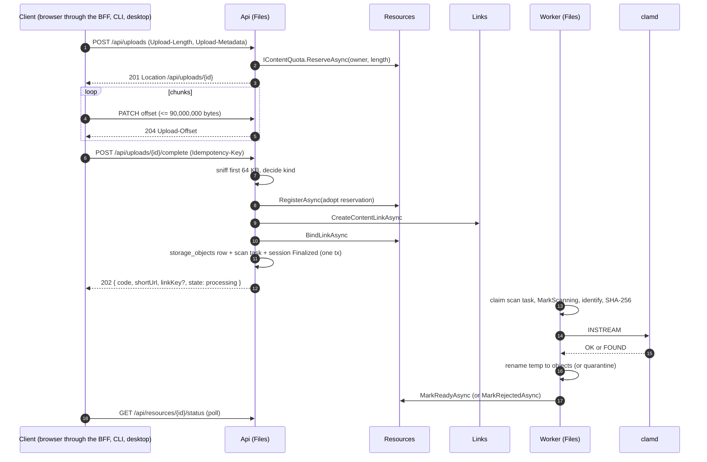

# ARC-009 · Upload pipeline (tus → temp → identify → scan → promote)

| | |
|---|---|
| Owner | zaagl-architect. Implementers: backend (Files module: BE-011, BE-012, BE-014, BE-020; Api endpoints; Worker), devops (OPS-007 to OPS-012), frontend (FE-013 through the BFF). |
| Status | DESIGN, ready to implement in slices (see `BUILD-ORDER-E1.2-E1.3.md`). Contracts C7, C8 (`src/Modules/Files/Contracts/FileContracts.cs`), C2 (`src/Modules/Resources/Contracts/ResourceContracts.cs`) are frozen; the four small additions F-9 to F-12 in `contracts.md` are proposed by this note. |
| Rules | Addendum §2.2, §6, §7, §9, §10.3, §11, §13, §16. PD-12, PD-15, PD-25, PD-28, PD-37, PD-45, PD-54, PD-55, PD-57 (APPROVED). |
| OPEN, not decided here | PD-16 (type allowlist, executables, encrypted archives, re-kinding), PD-13 (EXIF/GPS), PD-52 (Cloudflare terms), PD-11 (legal hold, CSAM). Each has an **interim default** below, marked **(interim)**, that is configuration and must not be read as a decision. |
| Related | ARC-006 (state machine, quota), ARC-008 (delivery), ARC-011 (media), ARC-012 (jobs), ARC-019 (burn, expiry, quota), `openapi-phase1.yaml` (Uploads, Resources tags), DEVOPS_PLAN §2. |

## 1. Rules in one place

| Rule | Value | Source |
|---|---|---|
| Transport | tus 1.0.0 at `https://api.zaa.gl/api/uploads`, through Cloudflare, every request body at most 90,000,000 bytes (`413 chunk-too-large`), clients default 64 MiB | PD-12, addendum §6.1 |
| Extensions offered | `creation`, `termination`, `expiration`; `checksum` (sha1) optional, not required by any client | addendum §6, this note §4.1 |
| `Upload-Length` | mandatory and at least 1; `Upload-Defer-Length` refused (`400 upload-length-required`); zero bytes (`Upload-Length: 0`) `400 validation` | addendum §6.2 |
| Checks before the first byte | principal, plan `MaxFileBytes` (`413 file-too-large`), quota reservation (`403 quota-exceeded`), disk admission (`507 insufficient-storage`) | addendum §6.2, §10.3 |
| Session id | a capability (UUIDv7, server generated) **and** the principal must match the creator, else `404` | addendum §6.3 |
| Idle expiry | 24 h after the last activity: temp bytes deleted, reservation released, then `410 upload-expired` | addendum §6.4 |
| Link timing | the link is issued at `/complete`, before the scan; viewer shows `processing`; no byte is served before `ready` | PD-28, addendum §6.6, §2.4 |
| Bytes | stored byte-for-byte; nothing re-encodes an original | addendum §6.7 |
| Scan | ClamAV on every file and media upload before `ready`; error, timeout or outage retried, then `rejected/scan-unavailable`; **never served unscanned, the owner included** | addendum §7.1 |
| Type | decided by sniffing the first 64 KB; the declared type and the file name never decide anything | addendum §7.2 |
| Storage layout | `<area>/<aa>/<bb>/<uuid>` with `aa/bb` = first two bytes of SHA-256 of the id text; the id is kept across `temp → objects → quarantine` (rename only) | `src/Modules/Files/Infrastructure/StorageKeys.cs:12-34`, `LocalObjectStorage.cs:86-104` |
| Accounts only in the first slice | guests, `simple` upload and `kind=file` come in slice 2 (`BUILD-ORDER-E1.2-E1.3.md`) | this note |

Config (all `Uploads:*`, `Scan:*`, `Storage:*`, read through `IOptions`, tests read them): `Uploads:MaxChunkBytes` 90,000,000;
`Uploads:SessionIdleHours` 24; `Uploads:Kinds` (`media` in slice 1, `media,file` from slice 2); `Uploads:GuestsEnabled` (false until slice 2);
`Uploads:DiskFloorPercent` 5; `Scan:Provider` (`Clamd` | `Fake`, `Fake` only when `ASPNETCORE_ENVIRONMENT=Development`, startup fails otherwise);
`Scan:Concurrency` 2; `Scan:RetryMinutes` `[1,5,15,60]` (the last value repeats); `Scan:MaxAttempts` 6; `Scan:TimeoutSeconds` 300.

## 2. Who owns what

| Piece | Module / host | Notes |
|---|---|---|
| tus endpoints, `/complete`, `/simple`, session table and expiry | Files, hosted in **Api** | writes only `temp/`; no CPU-heavy work |
| `scan` task (identify, hash, scan, promote, quarantine), `delete-bytes`, orphan sweep, reconcile | Files, hosted in **Worker** (ARC-012 §6) | `AddFilesModule` registers services; `AddFilesTaskRunner` registers the runner, Worker only (`src/Modules/Files/FilesModule.cs`, BE-013) |
| Resource row, quota, state, takedown | Resources (contracts C2) | Files never writes the `resources` schema |
| Link issuing | Links via `ILinkIssuer` (C1) | alias, lease, password, key are Links' |
| Derivatives, metadata | Media (ARC-011) | starts after `ready`; never blocks the link |
| Bytes to the browser | Resources `IDownloadGrants` + Files `IStoredObjects` + Nginx (ARC-008) | not this note |

`Files` references `Resources.Contracts` and `Links.Contracts` only (same shape as Snippets, ARC-010 §4.1 steps 7 to 10).



## 3. Tables (schema `files`, owned by Files; migrations `Initial` and `AddUploadPipeline`, expand-only)

The task table `files.tasks` already exists (`src/Modules/Files/Infrastructure/FilesDbContext.cs:13-21`, migration `AddTaskTable`).

```sql
CREATE TABLE files.upload_sessions (
  id uuid PRIMARY KEY,                          -- UUIDv7, = tus file id = files.storage_objects.id (kept across areas)
  owner_id uuid NULL, guest_creator_key bytea NULL,
  CHECK ((owner_id IS NULL) <> (guest_creator_key IS NULL)),
  declared_length bigint NOT NULL CHECK (declared_length >= 1),
  received_length bigint NOT NULL DEFAULT 0 CHECK (received_length BETWEEN 0 AND declared_length),
  declared_name text NULL,                      -- untrusted, display only, <= 255 bytes after sanitising (§9.3)
  declared_type text NULL,                      -- stored for support only; never read by any decision
  intended_kind smallint NOT NULL,              -- 1 file, 2 media (ResourceKind value of the declared kind)
  max_bytes bigint NOT NULL,                    -- plan MaxFileBytes at create
  reservation_id uuid NULL,                     -- IContentQuota reservation; null for guests
  resource_id uuid NULL,                        -- set by /complete step 3 (§6); the resume point
  status smallint NOT NULL DEFAULT 0,           -- UploadSessionStatus: 0 Open, 1 Complete, 2 Finalized, 3 Aborted, 4 Expired
  created_via smallint NOT NULL,
  idempotency_key_hash bytea NULL,
  created_at timestamptz NOT NULL, last_activity_at timestamptz NOT NULL, expires_at timestamptz NOT NULL
);
CREATE INDEX ON files.upload_sessions (status, expires_at) WHERE status IN (0, 1);
CREATE INDEX ON files.upload_sessions (owner_id, created_at DESC) WHERE owner_id IS NOT NULL;

CREATE TABLE files.storage_objects (
  id uuid PRIMARY KEY,                          -- = upload session id; the storage key is StorageKeys.Create(area, id)
  resource_id uuid NOT NULL UNIQUE,
  area smallint NOT NULL,                       -- StorageArea: 0 Temp, 1 Objects, 2 Quarantine
  size_bytes bigint NOT NULL,
  sha256 bytea NULL CHECK (octet_length(sha256) = 32),   -- set by the worker (§8 step 3)
  detected_mime text NULL, detected_ext text NULL,       -- set at complete (sniff), confirmed by the worker
  display_name text NOT NULL,                   -- sanitised (§9.3)
  scan_status smallint NOT NULL DEFAULT 0,      -- ScanVerdict: 0 Pending, 1 Clean, 2 Infected, 3 Error
  scan_signature text NULL, scan_engine text NULL, scanned_at timestamptz NULL,
  created_at timestamptz NOT NULL
);
CREATE INDEX ON files.storage_objects (sha256) WHERE sha256 IS NOT NULL;

CREATE TABLE files.idempotency_keys (...)       -- same shape as links.idempotency_keys; skip when BE-008 exposed a shared helper
CREATE TABLE files.storage_deletions (...)      -- outbox, shape per C7 / ARC-012 §3 (delete-bytes tasks may replace it)
CREATE TABLE files.blocked_content_hashes (sha256 bytea PRIMARY KEY, reason text NOT NULL, created_at timestamptz NOT NULL);
```

One storage object per upload (no cross-owner dedup in Phase 1: no existence oracle across tenants, no ref-counted delete).
`DATABASE_AND_STORAGE.md` §2.3 lists `file_items`; it is **not** a separate table here: `display_name`, `detected_mime` and
`size_bytes` live on `storage_objects`, because Media needs no second row for a file (decision, technical).

Session state machine (`UploadSessionStatus`), every change a conditional `UPDATE ... WHERE status = <from>`:

| From | To | Trigger | Effect |
|---|---|---|---|
| (none) | Open | create | reservation + row in one transaction (§5) |
| Open | Open | PATCH | `received_length`, `last_activity_at`, `expires_at = now + 24 h` |
| Open | Complete | the PATCH that makes `received_length = declared_length` | file made read-only (§4.3); further PATCH `409` |
| Complete | Finalized | `/complete` step 5 | storage object + scan task enqueued |
| Open, Complete | Aborted | tus `DELETE` | temp deleted, reservation released |
| Open, Complete | Expired | expiry job, idle > 24 h | same effects as Aborted; `410 upload-expired` afterwards |
| Finalized | (row deleted) | cleanup after 7 days | nothing else references it |

## 4. tus transport

### 4.1 Wire contract (frozen: `openapi-phase1.yaml` Uploads)

- `OPTIONS /api/uploads` (anonymous): `Tus-Resumable`, `Tus-Version: 1.0.0`, `Tus-Extension: creation,termination,expiration` (+ `checksum` when enabled),
  `Tus-Max-Size` = the caller's plan `MaxFileBytes` (guest cap when anonymous).
- `POST /api/uploads` `Upload-Length`, `Upload-Metadata` (`filename`, `filetype`, `kind` base64; all untrusted) -> `201`, `Location: /api/uploads/{id}`, `Upload-Expires`.
  `Upload-Metadata` is at most 4,096 bytes; `filename` decodes to at most 1,024 bytes (cut after sanitising, §9.3); `kind` must be in `Uploads:Kinds`, else `400 validation`.
- `HEAD /api/uploads/{id}`: `Upload-Offset`, `Upload-Length`, `Cache-Control: no-store`.
- `PATCH /api/uploads/{id}`: `application/offset+octet-stream`, `Upload-Offset` must equal `received_length` (`409 upload-offset-mismatch`); body at most 90,000,000 bytes;
  offset plus body above `declared_length` is `413 file-too-large`; a status other than Open is `410 upload-expired` (Expired, Aborted) or `409 already-finalized` (Complete, Finalized).
- `DELETE /api/uploads/{id}`: `204`; the first call aborts, later calls `404`.
- **Location through the BFF.** The API answers `Location: /api/uploads/{id}` (the path it sees). The browser reaches it as `/bff/api/uploads/{id}`
  (PD-23: no token in page script). The BFF proxy (`src/server/bff/handlers.ts` `handleProxy`, frontend-owned) rewrites a `Location` starting with
  `/api/uploads/` to `/bff/api/uploads/`, forwards every `Upload-*` and `Tus-*` header both ways, and streams chunk bodies (it already does for bodies above
  `REPLAYABLE_BODY_BYTES`, `handlers.ts:375-381`). Native clients call `api.zaa.gl` directly. Whether the BFF route handler streams a full 64 MiB PATCH is **unverified**;
  it is an acceptance test of FE-013 (`BUILD-ORDER-E1.2-E1.3.md` §4).

### 4.2 Library decision

Decision (technical): use **tusdotnet** with a custom store **if** its current release targets net10.0 (unverified at writing: check the package on the day BE-011 starts).
The store is ours either way: `ZaaglTusStore` implements `ITusStore`, `ITusCreationStore`, `ITusTerminationStore`, `ITusExpirationStore` over `files.upload_sessions` and a
Files-internal `ITempUploadFiles` (append at an offset, truncate, delete) whose paths come only from `StorageKeys.Create(StorageArea.Temp, id)`. The stock `TusDiskStore`
(flat `<dir>/<fileId>`) is **not** used: it would create a second layout beside C7. If tusdotnet does not support net10.0, BE hand-writes the five verbs (the protocol is small and the CLI
does the same, API_CONTRACTS §3.4); the **wire contract above is the contract, the library is not**. Authorize (`OnAuthorizeAsync`), plan/size/quota/disk (`OnBeforeCreateAsync`) and
`OnFileCompleteAsync` (only marks the session Complete) are the three hooks, as in API_CONTRACTS §3.2.

### 4.3 Per-request limits and integrity

- Kestrel's global body limit stays small; the tus PATCH and `/simple` endpoints raise `IHttpMaxRequestBodySizeFeature.MaxRequestBodySize` to 90,000,000 for that request only; `MinRequestBodyDataRate` 240 bytes/s, grace 10 s.
  A `BadHttpRequestException` (body too large) is mapped to the problem `413 chunk-too-large`.
- No form parsing anywhere on these routes. `/simple` MUST stream with `MultipartReader`; `IFormFile` / `ReadFormAsync` buffer and are forbidden (DATABASE_AND_STORAGE R4).
- Nginx (OPS-010): `client_max_body_size 90m`, `proxy_request_buffering off`, `proxy_http_version 1.1`, `proxy_read_timeout 300s` for `/api/uploads`. Kestrel enforces the exact 90,000,000.
- Appends go to the temp file at the declared offset with a flush before the DB update of `received_length`; a crash between them leaves the file longer than the row, so the next PATCH **truncates the file to `received_length`** before appending (the client is told the row's offset by `HEAD`).
- When `received_length = declared_length` the same transaction sets status Complete and the file is closed and made read-only (`chmod 0400` on Unix; on Windows dev an open-for-read-only handle policy, test only). **The bytes that are hashed, scanned and promoted are the same inode that stopped changing here**; nothing can append afterwards.
- Parallel PATCH for one session: a per-session `pg_try_advisory_xact_lock` taken in the PATCH transaction; the loser gets `409 upload-offset-mismatch`.

## 5. Create (order of refusals)

1. Credential: any failing credential `401` before anything (PD-36); no credential and `Uploads:GuestsEnabled = false` -> `503 guest_creation_paused`; API key needs `files:write` (`403 insufficient-scope`).
2. Guest only (slice 2): Turnstile (`guest-upload`) then the PD-14 counters (30/h, 60/24 h, shared with snippets) after the plan checks, refunded when the create fails.
3. Validate (no I/O): `Upload-Length` present, at least 1, no deferred length; metadata parses; `kind` allowed.
4. Idempotency claim when `Idempotency-Key` is sent (scope `u:<id>`).
5. Plan (`IContentPlanProvider`): `Upload-Length > MaxFileBytes` -> `413 file-too-large`.
6. Disk admission (§13): `507` with `Retry-After`.
7. One transaction: `IContentQuota.ReserveAsync(owner, Upload-Length)` (advisory lock, `403 quota-exceeded`) and insert the session (`Open`, `reservation_id`, `max_bytes`).
8. After commit, create the empty temp file. If it fails, the session is set Aborted and the reservation released. A crash between 7 and 8 leaves a session whose file does not exist yet: HEAD reports offset 0 and the first PATCH creates the file (no orphan file without a session is possible).
9. `201`.

## 6. Complete (the hand-off to Resources, Links and the Worker)

`POST /api/uploads/{id}/complete`, body `CompleteUploadRequest`, `Idempotency-Key` required, answer `202 CompleteUploadResponse`.
Steps; each is idempotent and the session row is the resume point, so a retry of the same request continues where the previous one stopped:

1. Principal and session (`404` for another principal). Status Open -> `409 upload-incomplete`; Aborted, Expired -> `410 upload-expired`; Finalized -> replay by idempotency (same key and body: stored response, `linkKey` null, ARC-002 Q1 OPEN; other key -> `409 already-finalized`).
2. Validate the body (no I/O): `title` at most 200 characters (control and bidi stripped), `expiresAt` clamped to `min(requested, now + RetentionDays)` (`400 expiry-beyond-plan`), `password` 4-128 (`402 plan_required` without `PasswordOnContent`), `burnAfterDownload` (`402 plan_required` without `BurnAfterDownload`; **slice 1: always `400 validation`**; media upload with burn: `400 validation`, burn applies to files only, ARC-019 §1), `customSlug` by the Phase 0 alias rules, `public` (guest `true`: `400 validation` until addendum §5.1.3 is confirmed).
3. **Sniff and decide the kind (synchronous, 64 KB read, milliseconds).** Run the detector (§9.1) on the first 64 KB of the temp file. The resource kind is fixed here because the link kind is fixed at issue (`LinkTargetKind` cannot change after the link exists):
   - declared `file` -> Resource kind `File`, whatever the bytes are (executable policy §9.2 still applies);
   - declared `media` and the detected type is on the media allowlist (§9.1) -> `Media`;
   - declared `media` and the detected type is not on the allowlist -> **(interim, PD-16)**: slice 1 `422 content-rejected` (`type-not-allowed`, session stays Complete so the client may re-declare `file` once files exist); from slice 2 it is **re-kinded to `File`** (the PD-16 recommendation) behind `Uploads:RekindMismatchedMedia = true`.
   A type that is not allowed at all (policy §9.2) is `422 content-rejected` here, before any resource exists, the reservation stays until abort or expiry.
4. `IResourceRegistry.RegisterAsync(Kind, owner, DeclaredSizeBytes = declared_length, ExpiresAt, Title, BurnAfterDownload, CreatedVia, AdoptReservationId = session.reservation_id)` (**change F-9**): Resources adopts the session's existing reservation instead of reserving again (T1 would otherwise reserve twice: `ResourceRegistry.cs:68-73` reserves inside `RegisterAsync` today). Store `session.resource_id` immediately after (own transaction). On retry, if `resource_id` is set, skip to step 5.
5. `ILinkIssuer.CreateContentLinkAsync(Kind, ResourceId, owner, ExpiresAt, customSlug, password, RequireLinkKey = !public)` (idempotency key = resource id; alias conflicts `409`). Then `IResourceRegistry.BindLinkAsync`.
6. One Files transaction: insert `storage_objects` (`id` = session id, `area = Temp`, `detected_mime`, sanitised `display_name`, `scan_status = Pending`), enqueue `files.tasks(kind = 'scan', dedupe_key = 'scan:<resourceId>', payload = {resourceId})`, set session `Finalized` and `resource_id`. (ARC-012 §3: enqueue in the same transaction as its cause.)
7. Complete the idempotency record; `202 { resourceId, code, shortUrl, linkKey, state: "processing", expiresAt }`. `MarkScanningAsync` is **not** called here: the worker calls it as its first step (idempotent, guard `S = Pending`), so there is one writer of that transition.

Target: the response is returned within 1 second of the request in the normal case (ARC-009 acceptance, ARCHITECTURE §6); steps 3 to 6 do no hashing and no scan.

| Crash after | State left | Repair |
|---|---|---|
| 4, before 5 | resource `Pending`, no link, session Complete with `resource_id` | client retries `/complete` (continues at 5), else orphan sweeper (ARC-006 T19, 24 h) releases the reservation and calls `OnResourceDeletedAsync` (Files deletes temp bytes) |
| 5 (link bound), before 6 | link exists, resource `Pending`, no task | client retry continues at 6; link shows `processing` until then, never bytes |
| 6 | all rows, task pending | none needed; worker runs |

## 7. Worker task `scan` (identify, hash, scan, promote, one task, steps idempotent)

Task `scan` in `files.tasks`, lease 10 minutes extended every lease/3, `max_attempts = Scan:MaxAttempts`, backoff `Scan:RetryMinutes` (ARC-012 §3-4).
Payload: ids only. The handler re-reads current state at the start of every step and does nothing if the effect already happened.

| # | Step | Effect | If it fails |
|---|---|---|---|
| 0 | Load task, `storage_objects`, `IResourceRegistry.GetAsync`. Resource state `Rejected`, deleted, disabled or purgeable -> complete the task, do nothing. Object already `Objects` + `Clean` + resource `Ready` -> complete. | | |
| 1 | `MarkScanningAsync` (guard `S = Pending`; no-op when already Scanning or Error) | | retry |
| 2 | Locate the file: `StatAsync(temp key)`; if missing, `StatAsync(objects key)` (a previous attempt promoted and crashed). Missing both -> `MarkRejectedAsync(scan-unavailable)` and a metric `files_object_missing` (alert). | | |
| 3 | **Identify and hash in one sequential read**: first 64 KB to the detector, SHA-256 and byte count over the whole file. Size must equal `declared_length` (greater than `max_bytes` -> reject `too-large`; otherwise treat as an Error, retried). Persist `sha256`, `detected_mime`, `detected_ext` (UPDATE, idempotent). | `sha256`, MIME | Error, retried |
| 4 | Category check: the detector's category must match the resource kind rules of §6 step 3 (media allowlist for `Media`). Mismatch -> `MarkRejectedAsync(type-not-allowed)`, temp deleted. `IContentHashBlocklist.IsBlockedAsync(sha256)` true -> `MarkRejectedAsync(blocked-hash, evidence)` (T9: takedown kind Abuse, quarantine). | | |
| 5 | **Scan** through `IMalwareScanner` (§10). Clean -> persist `scan_status = Clean`, `scan_engine`, `scanned_at`. Found -> step 6b. Error/timeout -> task fails and is retried; the object stays `Error`/`Pending`; nothing is served. | | |
| 6a | **Promote (clean).** `IObjectStorage.MoveAsync(temp key, Objects)` (atomic `rename(2)`, same filesystem; a repeat returns the same key, `LocalObjectStorage.cs:86-104`), fsync of the target directory. Then update `storage_objects.area = Objects`. **Then** `MarkReadyAsync(resourceId, size)` (T5: quota commit). Order matters: bytes are only reachable when the state is `Ready`, and `Ready` is set after the rename and after the area update, so the authorize hop never reads a key that does not exist yet. Then enqueue the media task for media kinds (ARC-011, `preview:<resourceId>:<derivative>`) after `ready`. | `Ready` | rename failure: Error, retried |
| 6b | **Infected.** `MoveAsync(temp key, Quarantine)`, `storage_objects.area = Quarantine`, `scan_status = Infected`, `scan_signature`; then `MarkRejectedAsync(infected, RejectionEvidence{Sha256, ObjectKey})` (**change F-10**): Resources applies T8: `Rejected/infected`, `bytes_state = 2`, `legal_hold_until = now + Abuse:EvidenceRetentionDays` (PD-11 OPEN), quota released, `ILinkTakedown(Safety)` with the evidence row (C12). | quarantined | retry; every call idempotent |

Retries exhausted (task dead after `Scan:MaxAttempts`): the dead-letter path runs `MarkRejectedAsync(scan-unavailable)` (T7), enqueues `delete-bytes` for the temp file, quota released.
The owner sees a **distinct** status "scanning failed, please upload again" for `scan-unavailable`, never the malware text (addendum §7.1.3); the OpenAPI `RejectedReason` already carries it.
Not malware, so no takedown and no abuse signal.

TOCTOU: the file is read-only and closed since the session became Complete (§4.3), the same inode is hashed, scanned and renamed. The scan result is recorded against the SHA-256 computed in step 3; promote asserts the file size still equals `size_bytes`.

## 8. Failure matrix (summary)

| Failure | Result | Never |
|---|---|---|
| clamd down or timing out | task retried (1, 5, 15, 60, 60 min), then `rejected/scan-unavailable`, temp deleted | served, or marked ready, unscanned |
| clamd configured with a stream limit below the file (`INSTREAM size limit exceeded`) | treated as Error and alerted as **configuration** (metric `scan_limit_exceeded`) | silently marked clean |
| infected | quarantine, `rejected/infected`, link taken down (safety), evidence kept | served; deleted before evidence retention ends |
| API restarts mid-upload | tus resumes: client `HEAD`, continues at the row's offset | data loss (file truncated to the row before append, §4.3) |
| worker killed mid-scan | lease expires after 10 min, task re-claimed, steps re-run | duplicate effect (each step idempotent) |
| rename done, DB not | next attempt finds the key in `objects/` (step 2) and finishes | a `ready` resource whose bytes are in `temp/` |
| object missing | `rejected/scan-unavailable`, metric and alert | serving a 404 as `ready` |
| disk full | create refused (`507`); PATCH write failure `507`, client resumes later | corrupting the session (offset only advances after flush) |
| blocked hash | `rejected/blocked-hash`, takedown Abuse | served |

## 9. Type detection, policy and file names

### 9.1 Detector

- Library: MimeDetective (first 64 KB). The declared type and the file extension are never inputs.
- **Slice 1 media allowlist (exact):** `image/png`, `image/jpeg`, `image/gif`, `image/webp`. Anything else declared `media` follows §6 step 3. PNG with an `acTL` chunk, animated GIF and animated WebP are **allowed as the same four types** (their `MediaType` is decided by ARC-011).
- Not in slice 1: `image/svg+xml` (ARC-011 §5, PD-18), `image/avif`, `image/heic`, video (PD-30), PDF (inline never). They are `type-not-allowed` for `media` and become `File` from slice 2 on (re-kinding).
- Polyglots (a valid PNG with a trailing ZIP or HTML) are accepted as PNG: they are served only as `image/png`, `nosniff`, sandbox CSP, never as markup (ARC-008 §7); the scan covers embedded malware.

### 9.2 Executables and archives (slice 2, PD-16 OPEN)

**(interim)** Executable detection (PE `MZ`+PE header, ELF, Mach-O, MSI/OLE installers, `.lnk`, shebang scripts) **or** a blocklisted extension (`.exe .dll .msi .bat .cmd .ps1 .vbs .js .jar .scr .com .lnk .sh`, applied to the *display name* only as an extra safety, never to decide a storage path) is refused with `422 content-rejected` (`type-not-allowed`) for guests and Free, allowed for Starter after the scan. Encrypted archives: clamd `AlertEncrypted yes` is on and the result is `rejected/type-not-allowed`, fail-closed, until PD-16 decides. Both are the PD-16 recommendation turned into configuration (`Uploads:BlockExecutablesFor = guest,free`), not a decision.

### 9.3 File name sanitiser (addendum §7.2), used for `display_name`, never in a path

In order: Unicode NFC; take the last segment after `/` or `\`; drop control characters (U+0000-001F, U+007F-009F) and bidi controls (U+202A-202E, U+2066-2069, U+200E, U+200F); replace `<>:"|?*` with `_`; trim leading and trailing spaces and dots; if the stem (before the first dot) is a reserved device name (`CON PRN AUX NUL COM1-9 LPT1-9`, case-insensitive) prefix `_`; cut to 255 UTF-8 bytes on a character boundary keeping the extension; empty result -> `file`. Extra: if the extension is not one of the detected type's extensions, append the detected extension (`photo.exe` holding PNG bytes becomes `photo.exe.png`). Test vectors (QA-026): `..\..\evil.png`, `a‮gpj.exe`, `CON.png`, `name. .`, a 400-byte name, an empty name, `.htaccess`.

## 10. ClamAV (fail-closed)

- Interface `IMalwareScanner.ScanAsync(Stream, CancellationToken) -> ScanResult { Clean | Found(signature) | Error(reason) }`, in Files.Infrastructure. Implementations: `ClamdScanner` (nClam over TCP `clamd:3310`) and `FakeScanner` (**Development only**, deterministic: EICAR string -> Found, `zaagl-fake-timeout` -> Error). Non-Development with `Scan:Provider = Fake` aborts startup.
- Mode: **INSTREAM** of the temp file for every Phase 1 size (at most 100 MB, below ClamAV's limits, addendum §7.1.4). No shared volume with clamd is needed, so clamd runs in a plain container and the dev machine needs only a fake. clamd configuration (OPS-009): `StreamMaxLength 120M`, `MaxFileSize 120M`, `MaxScanSize 200M`, `MaxRecursion 16`, `MaxFiles 10000`, `AlertExceedsMax yes`, `AlertEncrypted yes` (see §9.2), signatures refreshed by `freshclam` daily; readiness = `PING` and signature age under 48 h (older -> readiness fails, uploads stay `processing`, alert). `SCAN <path>` on a read-only mount of `temp/` (DEVOPS_PLAN §2.2) stays available as `Scan:Mode = Path` and is not used by default.
- Any transport error, timeout (`Scan:TimeoutSeconds`), unexpected reply or `ERROR` is `Error`. Only an explicit `stream: OK` is Clean. A reply other than `OK`/`FOUND` is never Clean.
- Tests (QA-025, QA-021): EICAR plain and inside a ZIP rejected and never downloadable; fake clamd (clean, found, timeout, closed connection, reply garbage); clamd stopped -> upload stays `processing`, then `scan-unavailable` after the retries, with a `FakeTimeProvider`.

## 11. Promote and atomic rename

- `MoveAsync` keeps the id: `temp/<aa>/<bb>/<id>` -> `objects/<aa>/<bb>/<id>`; the shard is a function of the id only, so source and target directories share the same `aa/bb`. One filesystem (OPS-002: XFS with `prjquota`, one mount `/srv/zaagl/storage`) makes it an atomic `rename(2)`; copy-then-delete is **forbidden** (a 100 MB copy per upload, and a window with two copies).
- Never serve from `temp/` or `quarantine/`: `GetInternalPath` refuses those areas (`LocalObjectStorage.cs:22`, `DeliverableAreas`), and the Nginx proxy container does not mount them (ARC-008 §10).
- After promote: file mode 0640, owner `zaagl`, group `zaagl-read` (DEVOPS_PLAN §2.2). The original is never opened for write again (ARC-011 §2).

## 12. Orphans and cleanup (BE-020, ARC-012 §4)

| Orphan | Detected by | Action |
|---|---|---|
| Session `Open`/`Complete` idle over 24 h | `UploadSessionExpiry` job every 15 min: `UPDATE ... SET status = Expired WHERE status IN (0,1) AND expires_at < now RETURNING` | delete the temp file (idempotent), release the reservation (`IContentQuota.ReleaseAsync`, T20). A PATCH racing the job sees `status != Open` and answers `410`. |
| Pending resource with no link, older than 24 h | Resources orphan sweeper (ARC-006 T19) | `IResourceKindHandler(File/Media).OnResourceDeletedAsync` -> Files queues `delete-bytes` for the temp object and removes its rows |
| Finalized session rows | job, 7 days | delete row |
| File in `temp/` without a session row | reconciliation (daily, off the backup window) | delete when `mtime` is older than `Storage:OrphanMinAgeDays` (7) |
| File in `objects/` or `quarantine/` without a `storage_objects` row | same | log, metric `files_orphan_bytes`, delete after 7 days (by `mtime`, which promote does not change) |
| `storage_objects` row whose file is in another area than the row says | same | repair the row to the file's actual area when the file is `objects/` and the scan is Clean; otherwise alert |
| Row without any file (`ready` resource) | same | metric and alert, mark the resource `Error` -> `scan-unavailable` path is **not** used (not an upload fault); admin decision |
| Quarantined bytes past `legal_hold_until` | `LegalHoldRelease` job daily | `delete-bytes`; evidence rows kept (PD-11 OPEN) |

The reconciliation never deletes anything younger than the minimum age and never touches a key that a task or session row references. It runs under `Jobs` pool limits and `nice`.

## 13. Disk admission (OPS-012, DEVOPS_PLAN §2.4)

At create (step 6 of §5): refuse with `507` + `Retry-After: 60` when `free_bytes(storage) - Σ(declared_length of Open and Complete sessions) - Uploads:DiskFloorPercent% of capacity < declared_length`. Thresholds on the storage filesystem (DevOps owns the numbers): 80% soft close (new sessions at most 100 MB, Free paused), 90% refuse all new sessions, snippets keep working, downloads and redirects never blocked. `free_bytes` is read by the Api from the filesystem (cached 10 s). Inodes are monitored too. Slice 1 may ship with a configured static floor if the metric is not ready; the `507` contract is fixed now.

## 14. Job hand-off summary (ARC-012)

| Kind | Table | Enqueued by | Dedupe key | Concurrency | On exhaustion |
|---|---|---|---|---|---|
| `scan` (identify, hash, scan, promote or quarantine) | `files.tasks` | `/complete` step 6 | `scan:<resourceId>` | `Scan:Concurrency` (2) | `MarkRejectedAsync(scan-unavailable)` + `delete-bytes` |
| `delete-bytes` | `files.tasks` (or `storage_deletions`, ARC-012 §3) | purge, guest expiry, burn finaliser (ARC-019), orphan sweep | `delete:<storageKey>` | 4 | retry; alert when 15 min after `due_at` |
| `upload-expiry`, `orphan-sweep`, `reconcile`, `legal-hold-release` | set queries on a timer | scheduler | none | 1 | next tick |

Worker hosting, leases, graceful shutdown and the redirect-priority limits are ARC-012 §5-6; this note adds nothing to them except that the **Api never runs `scan`** and the **Worker never serves a request**.

## 15. Contract changes proposed (source-compatible; recorded in contracts.md)

| # | Contract | Change |
|---|---|---|
| F-9 | C2 | `RegisterResourceCommand` gains trailing optional `Guid? AdoptReservationId = null`. When set, `RegisterAsync` does not reserve; it verifies the reservation (state reserved, same owner, `bytes = DeclaredSizeBytes`) and sets its `resource_id`. Without it, behaviour is unchanged (snippets). |
| F-10 | C2 | New `RejectionEvidence(byte[]? Sha256, string? ObjectKey)`; `IResourceRegistry.MarkRejectedAsync(resourceId, reason, RejectionEvidence? evidence = null)`. Resources forwards it to `ILinkTakedown` for `infected` and `blocked-hash`. |
| F-11 | C8 | New `IUploadStats { Task<int> CountOpenAsync(Guid userId, CancellationToken ct) }` in `Files.Contracts` (the `openUploads` field of `/api/me/storage`). |
| F-12 | C9 | New route `POST /api/resources/{id}/inline` (owner, purpose `Inline`); `/api/resources` list and detail fields completed (OpenAPI). |

## 16. Decided, interim and open

| Item | Status |
|---|---|
| tus on `api.zaa.gl`, 90,000,000-byte requests, session capability plus principal, 24 h idle | decided (PD-12, addendum §6) |
| Link at `/complete` before the scan, no byte before ready | decided (PD-28) |
| Local disk behind `IObjectStorage` | decided (PD-15) |
| INSTREAM mode, custom tus store, one `scan` task, kind fixed at `/complete`, `file_items` folded into `storage_objects` | technical decisions of this note |
| Media allowlist beyond PNG, JPEG, GIF, WebP; executables; encrypted archives; re-kinding | **OPEN (PD-16)**: interim as §6 step 3 and §9.2 |
| EXIF/GPS handling | **OPEN (PD-13)**: interim originals untouched (ARC-011 §4) |
| Legal hold length, evidence duties, CSAM | **OPEN (PD-11)** |
| Cloudflare terms for upload and large-file volume | **DEFERRED (PD-52)** |
| `linkKey` on an idempotent replay of `/complete` | **OPEN (ARC-002 Q1)**; built behaviour is `null` |
| Guest `public` at creation | to confirm (addendum §5.1.3) |

## 17. Review checklist for BE / OPS

- [ ] No path, key or file name is ever built from request data; every key comes from `StorageKeys.Create`.
- [ ] Reservation at create, adoption at register (F-9), commit at ready, release on abort, expiry, rejection: one reservation, never two.
- [ ] Nothing is served before `Ready`; `Ready` is set after rename and after the `area` update.
- [ ] The scan result is never Clean on anything except an explicit `OK`; `Fake` cannot start outside Development.
- [ ] Every worker step re-reads state and is safe to run twice; a killed worker loses nothing.
- [ ] PATCH truncates the file to the row's offset before appending; a completed file is read-only.
- [ ] `/complete` retry continues from `session.resource_id`; link kind is fixed from the sniff; the response is under 1 s without hashing.
- [ ] Kestrel limit raised only on tus PATCH and `/simple`; Nginx `client_max_body_size 90m`; `/simple` uses `MultipartReader`.
- [ ] `507` admission, `403 quota-exceeded`, `413 file-too-large` all happen before the first byte.
- [ ] A scan outage ends in `rejected/scan-unavailable` with its own owner message; a missing object alerts.

## 18. Questions for the user

1. **PD-16 (type policy)** is needed before slice 2: executables on Free, encrypted archives, HEIC/AVIF, and re-kinding a "media" upload that is really a document (interim as §9). Recommendation: approve the PD-16 text as written.
2. **Idempotent replay of `/complete` for keyed links** (ARC-002 Q1): a client that lost the first response cannot recover the key. Interim: no key on replay; the owner can make the link public from the library (`PATCH public: true`); reissuing a key on a keyed link has no implementation yet (`IContentLinkCommands.IssueNewLinkKeyAsync` is a contract only). Needs an answer before the uploader ships to users.
3. **Guest uploads** (PD-14 approved, but the first slice is accounts only): confirm that guests may upload images from slice 2, and the guest `public` rule (addendum §5.1.3).
