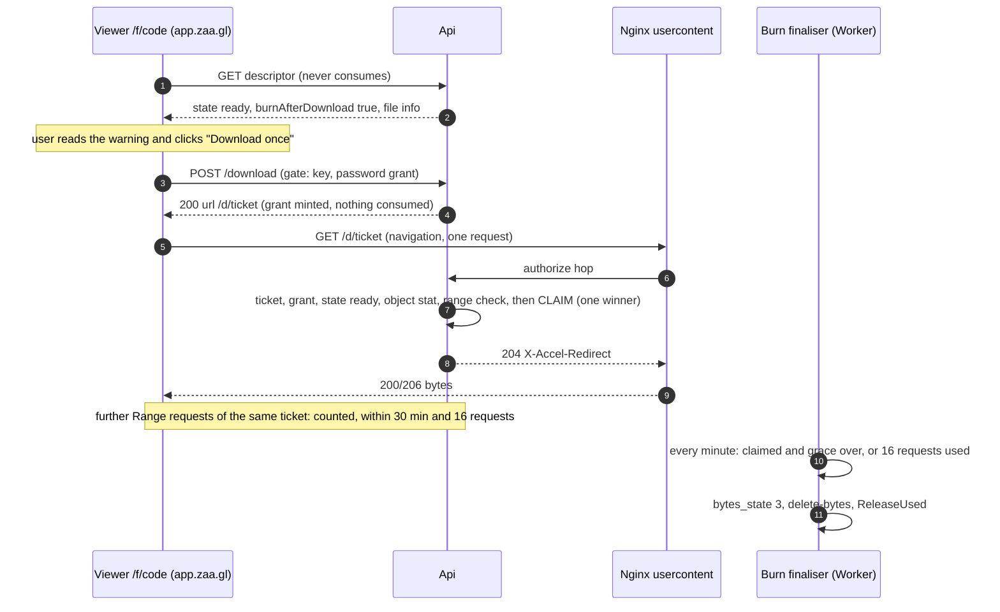

# ARC-019 · Ephemeral files: burn after download, expiry coupling, quotas

| | |
|---|---|
| Owner | zaagl-architect. Implementers: backend (BE-017, BE-018, BE-019, BE-021; Resources and Files), frontend (FE-017 `/f/[slug]`, FE-020, FE-025). |
| Status | DESIGN for slice 2 (`BUILD-ORDER-E1.2-E1.3.md`). New id: this note **extends** ARC-006 §5 (burn) and §3-4 (lifecycle, quota) with the file-level contract; it **does not change** their SQL, tables or transitions. Where it adds a column or a rule, §10 lists it. |
| Rules | Addendum §2.4, §8, §9, §10, §11, §12.5; PD-04, PD-05, PD-06, PD-14, PD-28, PD-54, PD-55 (APPROVED). ADR-0005, ADR-0006, ADR-0015. |
| OPEN, not decided here | burn CAPTCHA on the mint POST; owner email on burn; burn after view for snippets; what happens to a download interrupted after the grace (documented loss); takedown storage release (ARC-006 Q2); browser assembly of files above one response part. Interim defaults marked **(interim)**. |
| Related | ARC-006, ARC-008 §4-6, ARC-009, ARC-012 §4, ARC-004 §3, contracts.md C2, C3, C9. |

## 1. Rules in one place

| Rule | Value | Source |
|---|---|---|
| What burns | a **file** (`kind = File`) with `burn_after_download = true`. Media, snippets: not in Phase 1 (`400 validation`) | addendum §8.2.6 |
| Who may create one | capability `BurnAfterDownload`: Starter only; guests and Free `402 plan_required` | PD-54 |
| What consumes it | the **first GET** of a `Download` ticket minted by the button's POST, claimed atomically; exactly one request wins | PD-05, addendum §8.2.1-2 |
| What never consumes it | the `zaa.gl` redirect, the viewer page, the descriptor, `HEAD`, previews and thumbnails (none exist for burn files), owner downloads, any request without a minted ticket | addendum §8.2.4 |
| User-Agent | never read by any burn decision | addendum §8.2.4 |
| Grace after the claim | 30 minutes, at most 16 requests in total, for the claiming grant only (`Burn:GraceMinutes`, `Burn:MaxRequests`) | PD-05, addendum §8.2.3 |
| Unused ticket | expires 120 s after minting (`Content:DownloadTicketSeconds`) | addendum §8.1.2 |
| After the claim | state `burned` (`410`, "downloaded and deleted"), not renewable, burn flag cannot change (`409 burn-already-claimed`) | addendum §8.2.7 |
| Password on a burn file | a valid access grant is needed to **mint** | addendum §8.2.5 |
| Expiry | `min(requested, now + RetentionDays)`; account bytes kept to `purge_after`, guest bytes deleted at `expires_at`; burn overrides | PD-06, addendum §9 |
| Quota | reserve at create, commit at ready, free at purge (owner delete), at burn finalisation, on reject/abort | addendum §10.3, PD-55 |

## 2. Words used

- **Grant**: one row of `resources.download_grants` (ARC-006 §1), minted by `POST /api/public/content/{code}/download`, bound to the ticket (`grant id` in the HMAC payload).
- **Claim**: the conditional UPDATE of `resources.resources` that sets `burn_claimed_at` and `burn_grant_id` (ARC-006 §5 step 2). One per resource, ever.
- **Claiming grant**: the grant whose id is stored in `burn_grant_id`.
- **Continuation**: any later request of the claiming grant, counted by `request_count`.
- **Finalisation**: the job that, after the grace, deletes the bytes and releases the quota (ARC-006 T11).

## 3. Timeline of one burn file

## 4. Mint (`POST /api/public/content/{code}/download`)

Gate (ARC-004): state, link key, password grant, in that order; never consumes anything. Then, for a file:

| Condition | Answer |
|---|---|
| state `ready`, not burn, or burn not yet claimed | `200 { url, expiresAt }` (grant row, `first_use_by = now + 120 s`) |
| state `burned` (claim exists, grace running or over) | `410 burned` (the claiming client holds its own ticket; a second visitor cannot start) |
| `processing` | `409 processing`; `rejected` `422 content-rejected`; expired, deleted, disabled, taken down: `410` with the specific code (ARC-004 §3) |
| rate limit `download-grant` (30/min per IP partition and code) | `429` |

Minting many grants before the claim is allowed; only the first GET of any of them wins and the others get `410 burned`.
**(interim, OPEN)** no CAPTCHA on this POST for burn files; the optional Turnstile check is an additive header if the product owner decides otherwise.
Minting never reads the User-Agent.

## 5. The claim and the order inside the authorize hop

For a `Download` ticket on a burn resource, `GET`, the hop runs these checks in this order. Everything before step 7 is read-only; a refusal before step 7 consumes nothing (ARC-008 §4.3):

1. ticket length, version, kid, MAC (constant time), purpose value;
2. grant row exists, matches resource and purpose, `purpose = Download`;
3. resource state from the authoritative link snapshot (ARC-006 §2): `Ready`, or `Burned` where this grant is the claiming grant and within its grace (§6);
4. object present: `IStoredObjects.GetForResourceAsync`, area `Objects`, **`StatAsync` succeeds and size equals `size_bytes`**. This stops a claim on a file that cannot be delivered (a missing object would burn the file with nothing sent). Missing -> `410 gone` and a metric `files_object_missing`, no claim;
5. size and `Range` rule of ARC-008 §5 (`416 range-required`), **before** the claim: a request that is refused is never a consumption;
6. ticket `exp`: for an unclaimed ticket `now < first_use_by`; for the claiming grant the grace window replaces `exp` (§6);
7. **the claim**, one transaction with `SET LOCAL lock_timeout = '3s'`, exactly the two statements of ARC-006 §5 step 2 (resource row, then grant row), both must affect one row, else roll back. `55P03` -> `503 busy`, `Retry-After: 1`, and **nothing is consumed** (the transaction rolled back);
8. answer `204` with `X-Accel-Redirect` and the headers of ARC-008 §4.4.

Raw Npgsql, not `Database.SqlQuery` (R12). The statements are the single source in ARC-006 §5; do not copy them elsewhere.

### 5.1 Parallel requests: every case

| # | Situation | Result |
|---|---|---|
| P1 | 50 different grants, first GETs at the same instant | exactly one claim wins (the first UPDATE takes the row lock; the others re-evaluate `burn_claimed_at IS NULL`, find it set, update 0 rows); the other 49 answer `410 burned` |
| P2 | the **same** ticket requested twice at once (download manager, double click, browser retry) | one request wins the claim. The loser's claim UPDATE affects 0 rows, then it re-reads the resource: `burn_grant_id = @grant` -> it is a **continuation** (counted by the §6 statement, served) not `410`. A different `burn_grant_id` -> `410 burned` |
| P3 | claim in flight while the link expires | the claim statement repeats `link_expires_at > @now` (ARC-006 §5): refused, `410`, nothing served. A renewal whose C10 copy is up to a few seconds late can refuse a claim that would have been legal: fail-safe, no data lost, the user retries |
| P4 | claim racing an owner delete or an admin disable | delete: `deleted_at IS NULL` is in the claim; disable: the hop's state check (step 3) sees it from the link snapshot; a disable landing between 3 and 7 serves at most that one request, the next sees `Disabled` (ranks above `Burned`, ARC-006 §2) |
| P5 | claim racing the purge or the guest-expiry byte deletion | the claim requires `link_expires_at > now`, and byte deletion happens only after `purge_after`/`expires_at`, so a claimable file always has bytes; the delete tasks re-check under lock (§8) |
| P6 | `HEAD` at any time | validates and answers headers; never claims, never counts, never changes `request_count` |
| P7 | claim committed, worker crashed before the response | the claiming client has the ticket and may resume within the grace (continuation); nothing is lost |
| P8 | claim committed, Nginx cannot send (client gone) | same as P7: the same ticket resumes for 30 minutes and 16 requests; afterwards the file is gone and the loss is **documented** to the user (PD-05) |
| P9 | `Range` first request (`bytes=0-0` probes, parallel part downloads) | allowed to claim if acceptable under ARC-008 §5; the burn is **bytes requested**, not bytes completed (PD-05) |
| P10 | two parallel requests on different byte ranges of the claiming grant | each counted once, up to 16 in total |

## 6. Grace and continuation

For the claiming grant only: allowed while `now < burn_claimed_at + Burn:GraceMinutes` and `request_count < Burn:MaxRequests`, each request counted by the guarded UPDATE of ARC-006 §5 step 3. The ticket MAC is verified every time; only `exp` is replaced by the window.
`16` includes the claiming request. 16 is at least the part count of the largest Phase 1 burn file (two parts above `Content:MaxResponseBytes`) plus retries (ARC-008 §6).
The grace check uses the **database clock comparison in the statement**, not the finaliser: after the window the hop answers `410 burned` even if the finaliser has not run yet.
Non-burn files: tickets follow the reuse defaults of ARC-006 §5 step 5 (30 minutes, 16 requests after first use) so multi-part delivery works; owner tickets never touch burn columns.

## 7. Finalisation (T11) and what the user sees

`Burn finaliser` job (Resources, Worker, every minute, ARC-012 §4): resources with `burn_claimed_at` set, `bytes_state = 1`, and (`now >= claim + grace` or the claiming grant's `request_count >= Burn:MaxRequests`), `FOR UPDATE ... SKIP LOCKED`, batch 200. Per resource, one transaction: `bytes_state = 3`; then `IStoredObjects.QueueDeletionAsync(resourceId, "burn")` (Files, idempotent), `IContentQuota.ReleaseUsedAsync(resourceId)` (idempotent). `delete-bytes` carries `due_at`; "bytes still on disk 15 minutes after `due_at`" alerts (addendum §9.6).
A request in flight when the file is unlinked keeps its open file descriptor on Linux and completes; no new request is authorised after the grace (§6).
After finalisation the owner library shows the file as `burned` with the claim time; the descriptor answers `410 burned` ("downloaded and deleted"); the row is purged on the normal schedule (`link_purge_after`). Not renewable, burn flag locked (`409 burn-already-claimed`).
**Unclaimed** burn files are ordinary files for expiry: they expire at `expires_at`, enter quarantine for accounts, bytes deleted at `purge_after` (PD-06). Burn does not shorten expiry.

## 8. Expiry and purge, coupled to the link

The link owns the clock (`links.links.expires_at`, `purge_after`); the resource keeps copies (`link_expires_at`, `link_purge_after`) kept current by the C10 handler and used **only** by sweeps and the claim guard, never for state (ARC-006 §1).

| Event | Link | Resource | Bytes | Quota | Source |
|---|---|---|---|---|---|
| created | `expires_at = min(requested, now + RetentionDays)`; `purge_after = expires_at + 90 d` (guest: `= expires_at`) | copies set at register | temp -> objects | reserved -> used at ready | ARC-006 T1, T5 |
| expiry, account | `quarantined`, `410` | state `Expired` (computed) | **kept**, unreachable | still counted | PD-06, T12 |
| expiry, guest | `404` after purge (= expiry) | `bytes_state = 3` | **deleted now** | none (no ledger) | T13 |
| renew (before expiry or in quarantine) | `expires_at` forward, at most the plan maximum from now; moves `purge_after` | copies updated by `LinkRenewed` | kept | none | T14, spec §7.4 |
| owner delete | `deleted`, `410` | `deleted_at` | unreachable at once, **kept** to `purge_after` | freed only at purge | PD-55, T15, T18 |
| purge (`purge_after`) | purgeable, `404` | tombstone 30 days | `delete-bytes` (unless legal hold) | `ReleaseUsed` | T18 |
| burn claimed | unchanged (Links does not know) | `burned` | kept for the grace | counted until finalised | §7 |
| burn finalised | unchanged; resource row purged at `purge_after` | `bytes_state = 3` | deleted | `ReleaseUsed` | T11 |
| takedown (abuse, safety) | disabled | `bytes_state = 2`, legal hold | **quarantine**, not deleted | **(interim, ARC-006 Q2 OPEN)** keeps counting until the hold ends | T16 |

Details that BE-019 must implement:

- **The `zaa.gl` redirect of a burned or rejected file still answers `302` to the viewer** (Links cannot see resource state; ARC-003 §H1). The viewer then shows the state from the descriptor. This keeps the redirect at Phase 0 cost; do not add a resource lookup to H1.
- **Purge and download race:** the byte-deleting job and `PurgeResource` re-check under lock (`FOR UPDATE`): `link_purge_after <= now` and no active legal hold. A download authorised just before purge may finish (open descriptor); no download starts after `purge_after` because the link snapshot is `Purgeable` (state row 1, ARC-006 §2).
- **No expired resource is ever served** (the invariant of addendum §2.4): state is computed from the authoritative link state on every authorize, never from the job. The job only reclaims space.
- Jobs and cadence exactly as ARC-012 §4: `LinkExpired` emitter (1 min), lifecycle outbox drain (2 s), purge (`PurgeJob`, plus the Resources purge reaction), burn finaliser (1 min), `delete-bytes` (1 min), quota reconciliation (daily 03:00 UTC), grant cleanup (hourly, expired grants older than 1 day). **Grant cleanup must not lose the download counter:** see §10.
- Supersession: ARCHITECTURE.md §4.2 (bytes deleted at expiry, quarantined links not renewable) and DATABASE_AND_STORAGE §2.4 (`bytes_delete_after`) are **superseded** by PD-06 as changed and addendum §9; this note and ARC-006 are the reference.

## 9. Quotas (BE-021, `IContentQuota`)

### 9.1 Values (PD-54, configuration `Plans:<plan>:Content:*`, 1 MB = 1,048,576 bytes)

| | Guest | Free | Starter |
|---|---|---|---|
| `MaxFileBytes` | 26,214,400 | 26,214,400 | 104,857,600 |
| `StorageQuotaBytes` | none (creation counters instead) | 262,144,000 | 5,368,709,120 |
| `RetentionDays` | 7 | 7 | 30 |
| Burn, password on content | no | no | yes |

### 9.2 Flows for a file or media upload

| Moment | Call | Effect on the ledger |
|---|---|---|
| tus create | `ReserveAsync(owner, declared_length)` | `reserved += declared`; `403 quota-exceeded` if `used + reserved + declared > quota` (advisory lock, ARC-006 §4) |
| `/complete` | `RegisterAsync(..., AdoptReservationId)` (F-9) | none: the reservation is adopted by the resource (no second reserve) |
| clean + promote | `MarkReadyAsync` -> `CommitAsync(reservation, actual)` | `reserved -= declared`, `used += actual` (`actual = declared` for tus; `actual > declared` is refused -> `rejected/too-large`) |
| session aborted or expired, scan rejected, `scan-unavailable`, orphan | `ReleaseAsync` | `reserved -= declared` |
| purge, guest expiry, burn finalised | `ReleaseUsedAsync` | `used -= bytes` (idempotent per resource) |
| owner delete | none until purge | PD-55 |
| takedown | **(interim)** none until the legal hold ends | ARC-006 Q2 OPEN |

Invariants (QA-032 later): `used + reserved <= quota` after any reserve; never negative (CHECK); `used = Σ quota_usage` and `reserved = Σ open reservations` (daily reconciliation fixes and alerts on drift); 20 parallel creates for one owner never exceed the quota.
Guests write no ledger rows; a guest reservation is the synthetic `Guid.Empty` one and commit/release are no-ops (ARC-006 §1).
A downgrade is never applied retroactively; only new reservations see the new quota (ARC-006 §4, ARC-005 §7).
**(interim)** Derivatives are not charged (ARC-011 §10).

### 9.3 `GET /api/me/storage` (OpenAPI `StorageDto`)

`limits` from `IContentPlanProvider`; `usedBytes`, `reservedBytes`, `quotaBytes` from `GetUsageAsync`; `openUploads` from `IUploadStats.CountOpenAsync` (F-11). Cache: none (`no-store`). The uploader reads it before showing the drop zone and shows "x of y used"; a create that fails `403 quota-exceeded` shows the same numbers.

### 9.4 Disk admission

At session create, `507 insufficient-storage` with `Retry-After` (ARC-009 §13). Independent of the account quota: a user under quota can still be refused when the disk is full.

## 10. Schema and contract additions (all expand-only)

| # | Where | Change | Why |
|---|---|---|---|
| S-1 | `resources.resources` | `download_count bigint NOT NULL DEFAULT 0`, migration `AddDownloadCount` | `ResourceDescriptor.DownloadCount` exists (`ResourceContracts.cs:98`) but no column backs it (`ResourceRows.cs:25-50`), and grant cleanup would delete the evidence if it were derived from `download_grants` |
| S-2 | grant first use | in the same conditional UPDATE that sets `first_used_at` for a **non-owner `Download`** grant, `download_count += 1`. Continuations, `HEAD`, owner, raw and preview grants never increment | one source of truth, no analytics dependency (PD-10) |
| S-3 | `IDownloadGrants` (C2) | implement purposes `Download`, `Inline`, `Preview` and the claim (today refused with `validation`, `DownloadGrants.cs:58-59` and `:94`); disposition per ARC-008 §7 | slices 1 and 2 |
| S-4 | `resources.download_grants` | index `(resource_id)` exists; add `(first_use_by)` for cleanup | cleanup |

No change to the claim SQL, grace numbers or the burn columns.

## 11. Viewer and owner contract (FE-017, FE-020)

### 11.1 `/f/[slug]` (public) outcome table

| API result | Page |
|---|---|
| `200 state ready`, `burnAfterDownload: false` | file card (name, size, type, expires in), "Download" |
| `200 state ready`, `burnAfterDownload: true` | same card plus a prominent notice "This file can be downloaded once. After the download starts it is deleted." and the button "Download once" |
| `200 state processing` | "Preparing this file" (scan running); retry 1 s, at most 5, then manual refresh; no button |
| `401 password-required` | password form (`unlock`), then the card |
| `410 burned` | "This file was downloaded and has been deleted." (no button) |
| `410 expired`, `deleted`, `disabled`, `taken-down` | the ARC-003 §4.2 pages |
| `422 content-rejected` | neutral "This file is not available" (infected and `scan-unavailable` are owner-only details) |
| `404` | the not-found page (also a wrong or missing key) |

### 11.2 Rules the page MUST follow (they protect the burn)

- The descriptor never contains a download URL; the only way to get one is the button's `POST`.
- The page never requests the ticket URL itself (no `fetch`, no ``, no `<iframe>`, no prefetch, no HEAD probe). It hands the URL to the browser **once** by an anchor click or `location.assign` (one navigation).
- The URL is kept **in memory only** (not storage, not URL, not logs). A "Retry download" button after an interruption reuses that same URL while `now < claim + 30 min` (the page does not know the claim time: it offers retry for 30 minutes after the click). It does **not** mint again: a new ticket's first GET answers `410 burned`.
- After the click the page shows "Your download has started" and no longer shows the button. A reload shows the burned page.
- Burn files show no preview, no thumbnail, no inline anything.
- Files above `Content:MaxResponseBytes` (Starter 90 to 100 MB): **OPEN** how the browser assembles the parts (ARC-008 §5, §11 Q1). Slice 2 supports files at or below the cap; above it the page shows the file card and the message "Use the desktop app or CLI to download files above 90 MB" until the product owner chooses (a) fetch parts into a Blob, (b) service worker, (c) numbered parts. Recommendation (a).

### 11.3 Owner views

`GET /api/resources`, `/api/resources/{id}` (OpenAPI): state, `processingStatus`, `rejectedReason` (the distinct `scan-unavailable` message), `burnAfterDownload`, `burnClaimedAt`, `downloadCount`, `expiresAt`, `purgeAfter`, `isPublic`, size, type, `scan`. Owner can: rename (`title`), renew, toggle public/keyed, set or clear password (Starter), toggle burn **only before a claim**, delete, download with an owner ticket (`POST /api/resources/{id}/download`, never burns, available before the claim only for burn files, and for ready files generally).
A burn file in the library shows an "armed" badge, then "downloaded and deleted at <time>".

## 12. Tests (QA-030, QA-031, QA-032 when un-deferred; engineers write unit tests now)

Race tests need real Postgres (`localhost:5433`, no Docker needed): 50 concurrent first GETs on distinct grants (one 200/206, 49 `410`); the same ticket twice concurrently (P2: both served, count 2); claim vs expiry with `FakeTimeProvider`; claim vs delete; claim then 16 more requests (the 17th and every request after minute 30 are `410`); `HEAD` never changes any column; refused `416` consumes nothing; `55P03` consumes nothing; missing object does not claim; finaliser after a crash between claim and finalise; finaliser run twice; expiry of an unclaimed burn file; quota reserve race (20 parallel creates); purge vs download.

## 13. Decided, interim and open

| Item | Status |
|---|---|
| Claim by the first GET of a minted ticket, grace 30 min / 16 requests, burn Starter-only, files only | decided (PD-05, PD-54) |
| Bytes kept to `purge_after` for accounts; guest bytes deleted at expiry; delete frees quota at purge | decided (PD-06, PD-55) |
| Same-grant parallel request is a continuation (P2); object stat before claim; refusals consume nothing; `download_count` column | technical decisions of this note |
| CAPTCHA on the burn POST; owner email on burn; burn after view for snippets | **OPEN** (interim: none) |
| Takedown storage release | **OPEN (ARC-006 Q2)** (interim: keep counting) |
| Files above one response part | **OPEN (ARC-008)** (interim: slice 2 serves up to the cap) |
| Derivatives and quota | interim: not charged (ARC-011 §10) |

## 14. Review checklist for BE / FE

- [ ] The claim is the two statements of ARC-006 §5, in one transaction, raw Npgsql, `lock_timeout 3s`; 0 rows -> classify with a plain SELECT; same `burn_grant_id` -> continuation.
- [ ] Object stat, state and Range checks happen before the claim; every refusal consumes nothing.
- [ ] `HEAD`, descriptor, redirect, previews, owner tickets never touch `burn_claimed_at`, `burn_grant_id` or `request_count`.
- [ ] No code reads the User-Agent in mint, claim or hop.
- [ ] Finaliser: `SKIP LOCKED`, idempotent, deletes bytes and releases quota; the grace is enforced by the request path, not by the job.
- [ ] `download_count` has a column and is not derived from grants.
- [ ] The viewer never touches the ticket URL except one navigation; retry reuses the URL; never mints twice for one attempt.
- [ ] Quota: one reservation per upload, adopted, committed, released exactly once.

## 15. Questions for the user

1. **CAPTCHA on the burn POST** (Turnstile): yes or no. Recommendation: no for Phase 1 (the POST already needs a human click, a rate limit and, when set, a password).
2. **Owner notification when a burn file is claimed**: email, in-app only, or none. Recommendation: none in Phase 1; the library shows it.
3. **Takedown and the owner's storage** (ARC-006 Q2): free it at takedown (recommended) or when the legal hold ends.
4. **Interrupted download after 30 minutes or 16 requests** is lost by design (PD-05). Confirm the viewer copy states it clearly ("keep this page open until the download finishes").
5. **Burn for images/media and for snippets** stays out of Phase 1: confirm.
