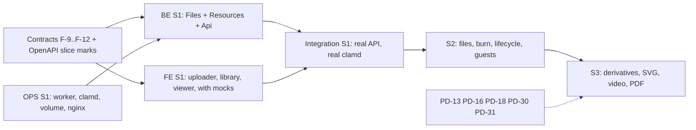

# Build order for E1.2 (images and media) and E1.3 (ephemeral files with burn)

| | |
|---|---|
| Owner | zaagl-architect (this plan); backend, frontend, devops, qa execute. |
| Status | READY for the agents to start. Supersedes the order of FEATURES_PLAN Steps 4 and 5 only in this respect: the **plain image slice** and the **files plus burn slice** come first; SVG, video, thumbnails and PDF preview follow because they wait for open product decisions (PD-13, PD-16, PD-18, PD-30, PD-31). Task ids, owners and detail documents are unchanged. |
| Designs | `ARC-009-upload-pipeline.md`, `ARC-011-media-fidelity.md`, `ARC-019-ephemeral-files-burn-expiry-quota.md`, `ARC-006`, `ARC-008`, `ARC-012`; wire: `openapi-phase1.yaml` (marked `x-zaagl-slice`); contracts: `contracts.md` (F-9 to F-12). |
| Rule | Ask the product owner before any commit, branch, push or worktree. Engineers keep the existing test suites green. |

## 1. Slice definitions

### Slice 1: plain images with ClamAV, and the image viewer ("S1")

**Done when:** a signed-in user drops or pastes a PNG, JPEG, GIF or WebP in the browser, gets a zaa.gl link at once, another person opens it, sees "processing" until the scan is clean and then the image at 100%; the bytes served hash to the bytes uploaded; the EICAR test file is rejected and never served; an upload killed halfway resumes.

| Included | Excluded (and where it goes) |
|---|---|
| Accounts only (JWT, device session, API key `files:write`) | guests, CAPTCHA, guest counters: S2 |
| tus create/HEAD/PATCH/DELETE/OPTIONS; sessions; quota reserve, release; 24 h expiry job | `/api/uploads/simple`, tus checksum: S2 |
| `/complete`: sniff, kind fixed, Register with adopted reservation, link, scan task | `kind=file`: S2 (`400 validation` until `Uploads:Kinds` includes it) |
| Media allowlist PNG, JPEG, GIF, WebP only | SVG, AVIF, HEIC, video: S3 / PD-16, PD-18, PD-30 (rejected `type-not-allowed`) |
| Worker `scan` task: hash, blocked-hash check, clamd INSTREAM (fail-closed), promote, quarantine | executables policy, encrypted archives: S2 (PD-16) |
| Tickets: `Inline` (viewer original), `Download` (attachment, no burn), `Owner`; authorize hop, X-Accel, Range, response cap | burn claim, grace, finaliser: S2 |
| Public descriptor for `kind = media`; `GET /api/resources`, `/{id}`, `/{id}/status`, `PATCH` (title, expiresAt, public), `DELETE`, `POST /{id}/inline`, `POST /{id}/download`; `GET /api/me/storage` | `burnAfterDownload` (any value true: `400 validation`), thumbnails (`thumbnailUrl` null), metadata beyond MIME (stub `IMediaReader`) |
| Password on content (Starter, already built in the link issuer): accepted, UI optional | derivatives, EXIF handling (originals untouched), `hasLocationData` |
| FE: uploader (FE-013), minimal `/files` library (FE-014), image viewer `/i/[slug]` (FE-015) | `/f/[slug]`, owner detail pages, PDF preview: S2 |
| OPS minimum: worker service, clamd service, storage volume with `temp objects quarantine`, Nginx usercontent block, `client_max_body_size 90m` for uploads, static disk floor | disk metrics and alerts at 70/80/90%, TLS automation, bandwidth controls: later |

### Slice 2: files and burn, lifecycle ("S2", E1.3)

**Done when:** a file up to the plan limit uploads, downloads once and is then gone; expiry removes it; the quota numbers are right under concurrency.

Adds: `kind=file` (any type under the interim PD-16 policy), guests and `/uploads/simple`, `/f/[slug]` page with burn, Download grants with claim, grace and the finaliser, expiry/purge coupling (BE-019), quotas endpoint and reconciliation (BE-021), orphan cleanup (BE-020), content abuse and takedown (BE-022), owner detail pages and library integration (FE-020, FE-025), re-kinding of mismatched "media" to file, QA-030 race suite.

### Slice 3: media extras ("S3", waits for decisions)

Thumbnails and metadata (BE-015), SVG raster view (BE-016, PD-18), video and posters (FE-016, PD-30), PDF preview (FE-018, PD-31), EXIF option (PD-13), extra formats (PD-16), `thumbnailUrl` in the library.

## 2. Dependency graph

## 3. Who starts what, in order

Each file has **one owner** (AGENT_TASKS ownership table). Shared contract files change only through the owner's PR and architect review.

### 3.1 Before anything (architect, now): done by this change

1. Design notes ARC-009, ARC-011, ARC-019 and this plan; OpenAPI with `x-zaagl-slice`; contracts F-9 to F-12 recorded (not yet in code).
2. Remaining gate: the **contract stubs** for F-9, F-10, F-11 are applied in code by the backend agent as the first commit of S1 (they are source-compatible: trailing optional parameters and one new interface), because backend owns those files. Frontend does not wait for them: it codes against the OpenAPI.

### 3.2 Backend S1 (order; BE agent)

| # | Task | Notes |
|---|---|---|
| 1 | Apply F-9, F-10, F-11 stubs; `Uploads:*`, `Scan:*` options | `ResourceContracts.cs`, `FileContracts.cs` |
| 2 | BE-011a: `files.Initial`/`AddUploadPipeline` migrations (`upload_sessions`, `storage_objects`, `blocked_content_hashes`, idempotency if not shared); `ITempUploadFiles`; tus store and endpoints (library decision ARC-009 §4.2); quota reserve/release; disk floor; session expiry job | `FilesEndpoints.cs` is an empty stub today (`src/Zaagl.Api/Endpoints/FilesEndpoints.cs:5`) and `MapFiles` must be mapped in `Program.cs` |
| 3 | `IMalwareScanner` with `FakeScanner` (Development) and `ClamdScanner`; fake clamd TCP server for tests | works without Docker (the dev machine has none, IMPLEMENTATION_PLAN §Risks) |
| 4 | BE-012: `/complete`, sniff and kind decision, filename sanitiser, `RegisterAsync(adopt)`, link, scan task | ARC-009 §6 |
| 5 | BE-014 (worker `scan` task): hash, blocked hash, scan, promote, quarantine, `MarkRejected(evidence)` | `Zaagl.Worker` runs it through `AddFilesTaskRunner` with `ITaskHandler<FilesDbContext>` handlers (runner exists, no handler yet, `FilesModule.cs`) |
| 6 | BE-017 subset: `IDownloadGrants` for `Inline`, `Download`, `Preview`(reserved), `Owner`; authorize hop branch for objects (headers, Range, cap) | `DownloadGrants.cs:58-59` refuses these today |
| 7 | Resources and Api endpoints: `/api/resources` list/detail/status/patch/delete/inline/download, `/api/me/storage`, `GET /api/public/content/{code}` for media; stub `IMediaReader` | OpenAPI is the shape |
| 8 | Tests: unit per piece, EICAR via fake clamd, kill-and-resume, hash equality of served bytes | no Docker needed |

Steps 2 and 3 are independent; 4 needs 2 and 3; 5 needs 4; 6 needs the Resources grants and can start with 2.

### 3.3 Frontend S1 (FE agent), in parallel from day one, against the OpenAPI with mocks

| # | Task | Notes |
|---|---|---|
| 1 | Mock layer from `openapi-phase1.yaml` (tus verbs, `/complete`, resources, public descriptor, tickets) | no waiting for the backend |
| 2 | FE-013 uploader: `tus-js-client` through `/bff/api/uploads` (our MUI UI), chunk 64 MiB, resume after reload (`tus-js-client` fingerprint), progress, cancel (`DELETE`), paste and drop images, then the complete form (title, expiry within plan, public toggle), result card with `shortUrl` + `#k=` copy button | see 4 |
| 3 | FE-014 `/files`: list by `kind`/`state` with keyset cursor, state chips (`processing`, `ready`, `rejected` with the distinct `scan-unavailable` copy, `expired`, `deleted`), copy link (key is only available from the creation response: show the full link once, `shortUrl` afterwards), delete, rename | no thumbnails in S1 |
| 4 | FE-015 viewer `/i/[slug]`: ARC-011 §9 | includes password gate, `processing` poll, error pages |
| 5 | en and ar strings, RTL | FE-021 rules |

### 3.4 DevOps S1 (OPS agent)

OPS-008 worker service and image (needs `Zaagl.Worker` Dockerfile), OPS-009 clamd (`StreamMaxLength 120M`, `MaxFileSize 120M`, `MaxScanSize 200M`, `AlertExceedsMax yes`, `AlertEncrypted yes`, PING readiness, signature age readiness), OPS-010 Nginx: `api.zaa.gl` upload location (`client_max_body_size 90m`, `proxy_request_buffering off`, `proxy_read_timeout 300s`) and `usercontent.zaa.gl` per ARC-008 §10, OPS-011/012 the storage mount (one filesystem for `temp objects quarantine`, nginx read-only on `objects`) and a static disk-floor setting. Tickets redacted in Nginx logs. Compose profile that runs the worker and clamd locally for CI (CI has Docker even though the dev machine does not).

### 3.5 Integration gate for S1 (architect and head)

Run against the real API, worker and clamd (CI): upload a PNG, JPEG, GIF, WebP; EICAR rejected; viewer shows the image; `sha256(served) == sha256(uploaded)`; kill the API mid-upload and resume; stop clamd and see `processing` then `scan-unavailable`; upload at the plan limit + 1 byte refused with `413` before any byte; second user cannot see the session (`404`).

## 4. Frontend facts to build against (contract-level, so no one guesses)

- **Browsers never hold a token** (PD-23). All upload calls go to `/bff/api/uploads...`. The BFF proxy already streams large bodies (`src/server/bff/handlers.ts:375-381`). It must (frontend-owned): (a) forward `Upload-*`, `Tus-*` request headers and return them (including `Upload-Offset`, `Upload-Expires`, `Tus-Resumable`, `Location`); (b) rewrite `Location: /api/uploads/{id}` to `/bff/api/uploads/{id}`; (c) pass CSRF on `POST`/`PATCH`/`DELETE` (tus-js-client `headers` option). **Acceptance test:** a 64 MiB PATCH streams through the BFF without buffering (unverified today).
- Chunk size: `chunkSize: 64 * 1024 * 1024` (at most 90,000,000 by contract; the default 64 MiB is `UploadProtocol.DefaultChunkBytes`). `retryDelays: [0, 1000, 3000, 5000]`. On `409 upload-offset-mismatch` tus-js-client re-HEADs and continues. On `410 upload-expired` start a new upload.
- `Upload-Metadata`: `filename`, `filetype`, `kind` (`media` for images in S1; the uploader sets `kind=file` only when the user picks "send as file", S2).
- After the last chunk the client calls `POST /api/uploads/{id}/complete` with a **generated** `Idempotency-Key` (UUID) and **stores it with the upload** so a retry after a lost response reuses it. The response may carry `linkKey` **once**; on a replay it is `null` (ARC-002 Q1 OPEN): the UI must show the full link (with `#k=`) immediately and never promise it can be shown again. Share URL = `shortUrl` + (`linkKey` ? `#k=` + `linkKey` : "").
- Processing: after `202`, poll `GET /api/resources/{id}/status` (1 s for 10 s, then 3 s; respect `Retry-After`) until `state` is `ready` or `rejected`. The link is already shareable (PD-28); say so.
- Quota and plan: read `GET /api/me/storage` (`limits.maxFileBytes`, `quotaBytes`, `usedBytes`, `reservedBytes`) before the drop zone is enabled; refuse files over `maxFileBytes` locally **and** handle the server `413`/`403 quota-exceeded`/`507`.
- Error mapping: `413 file-too-large`, `403 quota-exceeded`, `402 plan_required`, `507 insufficient-storage` (retry later copy), `503 busy` (auto retry after `Retry-After`), `422 content-rejected` (`type-not-allowed` in S1: "This file type is not supported yet"), `429`.
- The ticket URLs (`inlineUrl`, download URL) go to `https://usercontent.zaa.gl/d/...` directly from the browser; CSP `img-src`/`media-src`/`connect-src` per ADR-0023; the page sets `referrerpolicy="no-referrer"` on the ``.
- Library `thumbnailUrl` is null in S1: show a type icon, name, size, state chip. S3 adds thumbnails.
- S2 `/f/[slug]` rules: ARC-019 §11.

## 5. Quality gates per slice (QA tasks kept by the feature plan, plus engineers' own tests)

| Slice | Backend tests (engineer-written) | QA (kept tasks) |
|---|---|---|
| S1 | tus offset mismatch, parallel PATCH, truncate-to-row-offset, reservation release on DELETE/expiry, `/complete` crash matrix (ARC-009 §6), sniff vs declared type, filename vectors, fake-clamd matrix, EICAR (plain and in ZIP), promote crash windows, served-hash equality, ticket tamper/TTL/cross-resource, response headers on every status | QA-021 type detection corpus, QA-025 scan fail-closed (when un-deferred) |
| S2 | the burn cases of ARC-019 §5.1 and §12, finaliser idempotency, expiry vs claim, quota race, purge vs download, orphan sweep | **QA-030 burn race suite (kept)**, QA-031, QA-032 |
| S3 | bomb corpus, SVG corpus, FFmpeg abuse corpus | QA-022, QA-023, QA-024 |

## 6. Risks and how the order contains them

| Risk | Containment |
|---|---|
| tusdotnet may not support net10.0 | the wire contract is fixed; BE may hand-write the five verbs (ARC-009 §4.2); decide on the first day of BE step 2 |
| The BFF may buffer or drop `Upload-*` headers | FE acceptance test in S1; fallback is a thin streaming route handler dedicated to `/bff/api/uploads` |
| No Docker on the dev machine | `Scan:Provider = Fake`, fake clamd TCP server, local filesystem storage (already built, `LocalObjectStorage`); real clamd only in CI |
| Cloudflare terms and the 100 MB request limit (PD-52, deferred) | uploads stay at most 90,000,000 per request (ADR-0008); nothing in S1 or S2 depends on the outcome |
| Idempotent replay loses the link key (ARC-002 Q1) | uploader stores the first response; owner can make the link public (`PATCH public: true`) from the library; question listed for the product owner |
| Two reservations for one upload | F-9 adopt; test: after `/complete`, `reserved_bytes` equals the declared length, not twice |
| Burn claimed by a bot | tickets only by POST; hop checks before the claim; no User-Agent logic; QA-030 |

## 7. Open product questions to answer (none is decided by these documents)

| ID | Question | Blocks | Interim default (configuration) |
|---|---|---|---|
| PD-13 | EXIF/GPS: untouched only, opt-in strip (recommended), or strip by default | S3 option; privacy copy | untouched, no option |
| PD-16 | Allowed types: executables, encrypted archives, HEIC/AVIF/TIFF/RAW/PSD, re-kinding | S2 | S1 PNG/JPEG/GIF/WebP only; S2 executables blocked for guest and Free, encrypted archives rejected, mismatched media re-kinded to file |
| PD-30 | Video: transcode only non-playable (recommended), max duration per plan | S3 | no video |
| PD-31 | PDF preview: `react-pdf` or worker-rendered images | FE-018 | no preview (plain download page) |
| PD-18 | SVG: raster preview, original attachment only (proposed) | S3 | not accepted as media |
| ARC-002 Q1 | What a retried `/complete` returns for a keyed link | before the uploader ships | `linkKey: null` on replay |
| ARC-008 Q1 | Saving files above one 90 MB part (Starter) | S2 for files over 90 MB | S2 serves up to the cap |
| ARC-019 Q1-Q5 | burn CAPTCHA, owner email, takedown storage release, interrupted-download copy, burn scope | S2 | none, none, keep counting, documented, files only |
| PD-14 / addendum §5.1.3 | Guests: upload images in S2; may a guest choose public | S2 | guests disabled in S1; public refused for guests |
| PD-52 / PD-11 | Cloudflare terms; legal hold and CSAM | launch | deferred / open |
